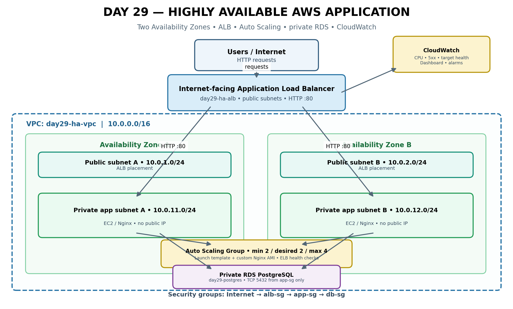

# Day 29/90 — Highly Available AWS Application Capstone

**DevOps Winter Arc · AWS Week · Day 7**  
**Topics:** Application Load Balancer (ALB) · Target Groups · EC2 Launch Template · Auto Scaling · Multi-AZ · RDS PostgreSQL · CloudWatch

> This README combines the task headings and requirements from the uploaded Day 29 PDF with the practical AWS Console stages used to implement them. The PDF is the source of the capstone scope; the detailed click-by-click workflow below expands its concise task brief.

---

## 1. Goal and scope

Design, and where budget allows deploy, a web application across two Availability Zones behind an Application Load Balancer. The application tier runs on private EC2 instances managed by an Auto Scaling Group. It connects to a private PostgreSQL database. CloudWatch monitors the environment, and a failure test demonstrates replacement of an application instance.

The Day 29 PDF says to reuse the Day 27 VPC, Day 25 EC2 bootstrap, and Day 26 private RDS only if those resources still exist and are safe to reuse. It warns that ALB, NAT Gateway, RDS, EC2, public IPv4, CloudWatch, and data transfer may cost money. It recommends a same-day test and cleanup window and a design-only path if costs are uncertain.

**Lab-specific note:** In this run, the previously created Day 27 VPC and Day 26 RDS had been deleted. The practical walkthrough therefore covered recreating a dedicated Day 29 VPC and private RDS after considering costs. That was the path taken in this lab, not a requirement to recreate deleted resources in every run.

## 2. Target architecture



### Architecture explanation

1. **Users / Internet:** Users send HTTP requests to the public DNS name of the Application Load Balancer.
2. **Application Load Balancer (`day29-ha-alb`):** An internet-facing Layer 7 load balancer placed in two public subnets, one in each Availability Zone. Its HTTP listener on port 80 forwards requests to the application target group.
3. **Public subnets:** `day29-public-a` (`10.0.1.0/24`) and `day29-public-b` (`10.0.2.0/24`) provide the ALB's public-facing network placement.
4. **Target group (`day29-ha-targets`):** Registers EC2 application instances on HTTP port 80 and checks the `/` path. Only healthy targets should receive normal traffic.
5. **Private application tier:** EC2 instances run Nginx in `day29-private-a` (`10.0.11.0/24`) and `day29-private-b` (`10.0.12.0/24`). They have no public IP addresses. The web page displays the EC2 instance ID so repeated requests can demonstrate requests reaching different instances.
6. **Auto Scaling Group (`day29-ha-asg`):** Uses a launch template and maintains minimum 2, desired 2, maximum 4 instances. It spans both private subnets and uses ELB health checks. It can replace unhealthy instances.
7. **Private RDS PostgreSQL (`day29-postgres`):** The database stays private. Its security group allows PostgreSQL TCP 5432 only from the application security group.
8. **Security group chain:** Internet → `day29-alb-sg` → `day29-app-sg` → `day29-db-sg`. Each tier accepts only the traffic it needs.
9. **CloudWatch:** Observes EC2 CPU, ALB request/error metrics, and target health. Dashboards and alarms help operators detect issues.

### Network plan used in this lab

| Resource | Name | CIDR / configuration |
|---|---|---|
| VPC | `day29-ha-vpc` | `10.0.0.0/16` |
| Public subnet A | `day29-public-a` | `10.0.1.0/24` |
| Public subnet B | `day29-public-b` | `10.0.2.0/24` |
| Private subnet A | `day29-private-a` | `10.0.11.0/24` |
| Private subnet B | `day29-private-b` | `10.0.12.0/24` |
| Region | — | `us-east-1` (N. Virginia) |

Use two distinct Availability Zones. AZ letters available to an account can vary; select two AZs and consistently place one public and one private subnet in each.

### Traffic and security group rules

| Security group | Inbound rule | Source |
|---|---|---|
| `day29-alb-sg` | HTTP TCP 80 | `0.0.0.0/0` for this lab |
| `day29-app-sg` | HTTP TCP 80 | `day29-alb-sg` |
| `day29-db-sg` | PostgreSQL TCP 5432 | `day29-app-sg` |
| `day29-ami-builder-sg` | SSH TCP 22, temporary only if needed | Your IP only |

The AMI-builder group is temporary and not part of the permanent application traffic chain. Production should use HTTPS with a suitable certificate and more restrictive ingress controls.

---

## 3. Key concepts

| Concept | Explanation |
|---|---|
| Application Load Balancer (ALB) | Layer 7 load balancer for HTTP/HTTPS. Routes requests to healthy targets and supports listener rules. |
| Target group | Defines backend targets, protocol/port, and health-check configuration. |
| Health check | A periodic request (here HTTP `/`) used to determine whether an application target is healthy. |
| Launch template | Reusable EC2 launch configuration: AMI, instance type, security group, IAM instance profile, metadata options, and user data. |
| Custom AMI | Reusable machine image. We used it to preinstall Nginx so private instances do not need to download packages at boot. |
| User data | Startup script executed during instance launch. Here it obtains the instance ID using IMDSv2 and writes it into the Nginx page. Never place passwords or access keys in user data. |
| Auto Scaling Group (ASG) | Maintains desired EC2 capacity, replaces unhealthy instances, and can scale within configured minimum/maximum limits. |
| ELB health checks in ASG | Lets ASG use load-balancer target health when deciding whether an instance is healthy. EC2 checks alone may not detect an application failure while the VM is running. |
| Multi-AZ | Spreads application capacity across separate Availability Zones to reduce dependence on one zone. |
| RDS private database | Managed relational database not directly exposed to the public internet. App-to-DB access is restricted by security groups. |
| Security group | Stateful virtual firewall attached to resources. Referencing a source security group expresses tier-to-tier trust. |
| CloudWatch | Collects service metrics and logs, visualizes metrics, evaluates alarms, and can notify through SNS or support scaling policies. |
| SNS | Notification service used to deliver alarm notifications, for example by email after subscription confirmation. |
| Target tracking scaling | ASG scaling policy that adjusts capacity to maintain a target metric, such as average CPU utilization. |
| IMDSv2 | Instance metadata access using a session token. Configure metadata tokens as required. |
| NAT Gateway / VPC endpoints | Provide private subnet egress or private access to AWS services. NAT Gateways and many endpoints incur charges. |

---

## 4. Task A — Pre-flight planning

### A1. Confirm the environment

1. Select the correct AWS account and Region (`us-east-1` in this lab).
2. Check whether the Day 27 VPC still exists and has two public and two private subnets across two AZs.
3. Check whether the Day 26 RDS is private and available.
4. Reuse existing resources only if they are correct, safe, and not shared by another project.
5. If resources were deleted, assess costs before recreating them. The PDF recommends design-only if cost is uncertain.
6. Record a same-day testing and cleanup window.

### A2. Record names and cost assumptions

Use consistent names to avoid deleting another lab's resources. Record the Region, resource names, instance type, RDS class/storage, whether NAT is used, and intended cleanup time.

### A3. Prepare the Nginx application page

The page should display the EC2 instance ID. This makes it possible to observe requests reaching different instances through the ALB.

---

## 5. Task B — Security group chain

Create the security groups in **EC2 → Network & Security → Security Groups**. For each group, choose VPC `day29-ha-vpc`.

### B1. ALB security group

- Name: `day29-alb-sg`
- Inbound: HTTP TCP 80 from `0.0.0.0/0` for this lab.
- Outbound: allow required traffic to application targets (the default allow-all egress is commonly used for this lab).

### B2. Application security group

- Name: `day29-app-sg`
- Inbound: HTTP TCP 80, source = security group `day29-alb-sg`.
- Do not allow HTTP from `0.0.0.0/0` directly to private app instances.

### B3. Database security group

- Name: `day29-db-sg`
- Inbound: PostgreSQL TCP 5432, source = security group `day29-app-sg`.
- Do not make the database publicly accessible.

### B4. Optional temporary AMI-builder security group

For the Option B custom AMI workflow, a temporary Ubuntu builder was launched in a public subnet. If SSH is used, allow TCP 22 from **My IP only**, not from the whole internet. Remove this temporary group during cleanup.

---

## 6. Task C — Launch template

The PDF baseline is a suitable Ubuntu AMI (or Day 25 AMI), `t3.micro` as its example, `app-sg`, an SSM-capable instance profile, and IMDSv2. The template must use real IDs/values from the account. Do not put database passwords or access keys in user data.

### C1. Create an EC2 IAM role / instance profile

1. Open **IAM → Roles → Create role**.
2. Select **AWS service → EC2**.
3. Attach `AmazonSSMManagedInstanceCore` if Systems Manager access is intended.
4. Name the role `Day29-EC2-SSM-Role`.
5. Ensure an instance profile is available for selection in the EC2 launch template.

**Important:** An IAM role alone does not make a private instance reachable through Systems Manager. Private connectivity to SSM generally requires suitable VPC endpoints or NAT connectivity, plus a working SSM Agent and DNS/network configuration. The no-NAT Option B path may not have SSM connectivity unless endpoints are configured.

### C2. Option B — Bake Nginx into a custom AMI

This is the practical path selected in this lab to avoid requiring a NAT Gateway just to install Nginx on private instances.

1. Launch a temporary Ubuntu EC2 instance in `day29-public-a`.
2. Enable a public IPv4 address for the temporary builder.
3. Attach a temporary builder security group allowing SSH from your IP only, or use a properly configured management method.
4. Connect to the builder.
5. Install Nginx:

```bash
sudo apt-get update
sudo apt-get install -y nginx curl
```

6. Write a generic HTML page. Do not bake the builder's instance ID into the image:

```bash
sudo tee /var/www/html/index.html > /dev/null <<'EOF'
<html>
<head><title>Day 29 HA Application</title></head>
<body>
  <h1>Highly Available Application</h1>
  <h2>Day 29 AWS Capstone</h2>
  <p>Nginx is running.</p>
  <p>Instance information will be added at startup.</p>
</body>
</html>
EOF
```

7. Enable and test Nginx:

```bash
sudo systemctl enable nginx
sudo systemctl restart nginx
sudo systemctl status nginx --no-pager
curl -I http://localhost
curl http://localhost
```

8. In **EC2 → Instances**, select the builder and choose **Actions → Image and templates → Create image**.
9. Name the image `day29-nginx-custom-ami`.
10. Leave the reboot option enabled for filesystem consistency unless there is a specific reason not to.
11. Wait until the AMI status is **Available**.
12. Record the AMI ID and associated snapshot IDs.
13. Terminate the temporary builder after the AMI is available. Keep the AMI and snapshots until the capstone is complete.

### C3. Create or update the launch template

Create `day29-ha-launch-template` or create a new version of the existing template.

| Setting | Value |
|---|---|
| AMI | `day29-nginx-custom-ami` for Option B |
| Instance type | Suitable lab type; PDF example: `t3.micro` |
| Security group | `day29-app-sg` |
| IAM instance profile | SSM-capable profile if configured |
| Metadata version | IMDSv2 required |
| User data | Script below |

User data for the baked-Nginx AMI:

```bash
#!/bin/bash
TOKEN=$(curl -sS -X PUT \
  "http://169.254.169.254/latest/api/token" \
  -H "X-aws-ec2-metadata-token-ttl-seconds: 21600")

INSTANCE_ID=$(curl -sS \
  -H "X-aws-ec2-metadata-token: $TOKEN" \
  "http://169.254.169.254/latest/meta-data/instance-id")

cat > /var/www/html/index.html <<EOF
<html>
<head><title>Day 29 HA Application</title></head>
<body>
  <h1>Highly Available Application</h1>
  <h2>Day 29 AWS Capstone</h2>
  <p>Running on EC2 Instance: $INSTANCE_ID</p>
</body>
</html>
EOF

systemctl enable nginx
systemctl restart nginx
```

Save the new launch template version and ensure the ASG uses the version containing the custom AMI and startup script.

**Alternative:** The PDF allows a suitable Ubuntu AMI or the Day 25 AMI and reuse of the Day 25 bootstrap script. If using a standard Ubuntu AMI in private subnets, package installation needs NAT or suitable egress. Option B avoids that package-download dependency by baking Nginx into the AMI.

---

## 7. Task D — ALB, target group and Auto Scaling

### D1. Create the target group (Stage 5)

1. Open **EC2 → Target Groups → Create target group**.
2. Target type: **Instances**.
3. Name: `day29-ha-targets`.
4. Protocol: **HTTP**.
5. Port: **80**.
6. VPC: `day29-ha-vpc`.
7. Health check protocol: HTTP.
8. Health check path: `/`.
9. Success code: `200`.
10. Leave targets unregistered; the ASG will register them later.
11. Create the target group.

### D2. Create the internet-facing ALB (Stage 6)

1. Open **EC2 → Load Balancers → Create load balancer → Application Load Balancer**.
2. Name: `day29-ha-alb`.
3. Scheme: **Internet-facing**.
4. IP address type: IPv4.
5. VPC: `day29-ha-vpc`.
6. Select both public subnets: `day29-public-a` and `day29-public-b`, in separate AZs.
7. Attach `day29-alb-sg`.
8. Add listener HTTP port 80.
9. Set its default action to forward to `day29-ha-targets`.
10. Create the ALB and wait for state **Active**.
11. Record the ALB DNS name.

The ALB may return an error before the ASG has registered healthy targets. That is expected before D3 is complete.

### D3. Create the Auto Scaling Group (Stage 7)

1. Open **EC2 → Auto Scaling Groups → Create Auto Scaling group**.
2. Name: `day29-ha-asg`.
3. Select `day29-ha-launch-template`.
4. Select the version containing `day29-nginx-custom-ami` and the correct user data.
5. Choose VPC `day29-ha-vpc`.
6. Select private subnets `day29-private-a` and `day29-private-b`.
7. Attach to an existing target group: `day29-ha-targets`.
8. Set health check type to **ELB**.
9. Set a suitable health-check grace period; this walkthrough used 180 seconds.
10. Set minimum 2, desired 2, maximum 4.
11. Add tags such as `Name=day29-ha-app-instance`, `Project=DevOps-Winter-Arc`, `Day=Day29`, `Environment=Lab`, propagating them to instances if offered.
12. Review and create the ASG.

Wait for two EC2 instances to launch and both target-group targets to become **Healthy**.

### D4. Verify the traffic chain

- ALB is Active.
- Listener HTTP:80 forwards to `day29-ha-targets`.
- Target group health check uses HTTP `/`.
- App security group allows TCP 80 only from `day29-alb-sg`.
- Instances are in private subnets and have no public IP.
- Target group shows two healthy instances.

---

## 8. Task E — Failure and recovery test (Stage 8)

### E1. Test the ALB DNS name

Open:

```text
http://YOUR-ALB-DNS-NAME
```

The page should display the EC2 instance ID.

### E2. Send repeated requests

PowerShell:

```powershell
$ALB = "YOUR-ALB-DNS-NAME"

1..10 | ForEach-Object {
    Write-Host "Request $_"
    (Invoke-WebRequest -Uri "http://$ALB" -UseBasicParsing).Content
    Start-Sleep -Seconds 2
}
```

Linux / macOS / WSL:

```bash
for i in 1 2 3 4 5 6; do
  curl -s http://YOUR-ALB-DNS-NAME
  echo
done
```

Observe at least two different instance IDs across repeated requests. The ALB does not promise strict alternation; requests may reach the same target more than once.

### E3. Terminate one lab instance only

1. Confirm both targets are healthy.
2. Open **EC2 → Instances**.
3. Identify an instance belonging to `day29-ha-asg` by its tags and ASG membership.
4. Terminate only that lab instance.
5. Do not terminate an instance from another project or shared environment.

### E4. Observe recovery

1. Open **EC2 → Auto Scaling Groups → day29-ha-asg → Instance management**.
2. Inspect the ASG activity history.
3. Observe the replacement instance launch.
4. Open **Target Groups → day29-ha-targets → Targets**.
5. Wait for the replacement to become Healthy.
6. Continue sending requests to the ALB during and after recovery.

Expected result: the remaining healthy instance can continue serving while ASG launches a replacement. A brief interruption is possible if no healthy target remains or the application is otherwise unhealthy; do not claim zero downtime unless the test evidence supports it.

Record the terminated instance ID, replacement instance ID, time of termination, ASG replacement activity, target health before/after, and ALB responses during recovery.

---

## 9. Task F — Scaling and monitoring (Stage 9)

### F1. Metrics to inspect

Open **CloudWatch → Metrics → All metrics**.

| Namespace / metric | Purpose |
|---|---|
| EC2 `CPUUtilization` | CPU usage per instance |
| ApplicationELB `RequestCount` | Requests received by the ALB |
| ApplicationELB `HTTPCode_ELB_5XX_Count` | 5xx responses generated by the ALB |
| ApplicationELB `HTTPCode_Target_5XX_Count` | 5xx responses generated by registered targets |
| ApplicationELB `HealthyHostCount` | Healthy targets |
| ApplicationELB `UnHealthyHostCount` | Unhealthy targets |

Use dimensions that identify the actual load balancer, target group, and instance. Metrics may take time to appear. Expected steady state after successful setup is two healthy targets and zero unhealthy targets.

### F2. Create a CloudWatch dashboard

1. Open **CloudWatch → Dashboards → Create dashboard**.
2. Name it `day29-ha-dashboard`.
3. Add a line widget for EC2 `CPUUtilization` for current ASG instances.
4. Add an ALB widget for `RequestCount` and 5xx metrics.
5. Add a target-health widget for `HealthyHostCount` and `UnHealthyHostCount`.
6. Save the dashboard.

### F3. Create a monitoring alarm

The practical console walkthrough created an EC2 CPU alarm:

- Name: `day29-ec2-high-cpu-alarm`
- Metric: EC2 `CPUUtilization` for a selected instance
- Statistic: Average
- Period: 5 minutes
- Condition: Greater than 70%
- Evaluation: 1 out of 1 periods

This is a basic monitoring alarm, not an ASG scaling policy. It is instance-specific; if ASG replaces that instance, the alarm still refers to the old instance ID.

The original PDF specifically recommends a CloudWatch alarm for **5xx errors or `UnHealthyHostCount`** and a dashboard for requests, healthy hosts, and CPU. Add one of those alarms if completing the source task exactly. Do not claim an alarm fired unless you observed the expected state.

### F4. Target-tracking scaling policy — PDF task

The PDF's scaling task also asks for a target-tracking policy based on average ASG CPU utilization, using **50%** as its example target.

Console workflow:
1. Open **EC2 → Auto Scaling Groups → day29-ha-asg**.
2. Open the **Automatic scaling** tab.
3. Choose **Create dynamic scaling policy**.
4. Select **Target tracking scaling policy**.
5. Choose average ASG CPU utilization as the metric.
6. Set target value to `50`.
7. Review cooldown / instance warm-up settings and create the policy.

This policy may launch additional instances and increase cost. The ASG maximum remains 4. The PDF recommends a controlled load test only on your own lab instances and stopping it after observing scaling. Skip load generation if cost or resource safety is uncertain; document the policy design instead.

### F5. Optional SNS email notification

1. Open **Amazon SNS → Topics → Create topic**.
2. Create a standard topic such as `day29-ha-alerts`.
3. Create an email subscription using an address you can access.
4. Confirm the subscription from the email.
5. Select the topic as the CloudWatch alarm notification action.

A pending email subscription will not receive notifications until confirmed.

### Monitoring scope clarification

The guided console steps created a dashboard and described an EC2 CPU alarm. The PDF's additional target-tracking policy and 5xx / unhealthy-host alarm are separate tasks. Mark each complete only if you actually configured and verified it. Metrics being visible does not mean an alarm fired.

---

## 10. Troubleshooting

Use these checks in order. Confirm the affected resource belongs to this Day 29 lab before changing it.

### 10.1 ALB returns 503 Service Unavailable

**Likely meaning:** The ALB has no healthy targets available.

1. Open **EC2 → Target Groups → day29-ha-targets → Targets**.
2. Check target health and the reason shown for unhealthy targets.
3. Confirm target group uses HTTP port 80 and health path `/`.
4. Confirm Nginx is installed and running in the AMI.
5. Confirm launch template user data completes successfully.
6. Confirm `day29-app-sg` allows TCP 80 from `day29-alb-sg`.
7. Confirm instances are registered in the correct target group and VPC.
8. Wait for initial boot and health checks before changing settings.

### 10.2 ALB returns 502 Bad Gateway

1. Check target health and target response.
2. Confirm Nginx is running and listening on port 80.
3. Confirm the application returns a valid HTTP response.
4. Inspect instance system logs / console output and application logs where access is configured.
5. Check security group rules and target-group protocol/port.
6. Check whether a recent AMI or user-data change broke startup.

### 10.3 ALB DNS name is unreachable

1. Confirm ALB state is **Active**.
2. Confirm it is internet-facing.
3. Confirm it is mapped to public subnets in two AZs.
4. Confirm public route table has `0.0.0.0/0` pointing to the attached Internet Gateway.
5. Confirm `day29-alb-sg` allows inbound HTTP TCP 80 from the internet for this lab.
6. Confirm an HTTP listener exists on port 80.
7. Check the ALB DNS name and include `http://`.

### 10.4 Targets stay Initial or Unhealthy

1. Allow time for EC2 boot and the configured grace period.
2. Confirm target group health path `/` is served by Nginx.
3. Confirm target port is 80.
4. Confirm `day29-app-sg` source is `day29-alb-sg`.
5. Confirm correct launch template version and AMI are selected.
6. Confirm instance and target group are in the same VPC.
7. Inspect instance system log / user-data outcome if you have a management path.

### 10.5 Instances are repeatedly replaced

1. Open ASG **Activity** / **Activity history** and read the replacement reason.
2. Check whether ELB health checks are enabled intentionally.
3. Check health-check grace period.
4. Check target health and Nginx startup.
5. Check launch template version, AMI, security group, and user data.
6. Fix the underlying application or health-check issue before allowing repeated launches to continue.

### 10.6 Private instances cannot install Nginx

A private subnet with only a local route has no general internet egress. `apt-get` cannot download packages without a suitable egress path.

- **Chosen in this lab:** bake Nginx into a custom AMI using a temporary builder in a public subnet.
- Use a NAT Gateway for outbound internet access (paid).
- Configure suitable VPC endpoints for AWS services; endpoints do not automatically provide general internet access or Ubuntu package repository access.

Do not add a NAT Gateway without checking its hourly and data-processing costs.

### 10.7 Systems Manager cannot connect to private EC2

1. Confirm the EC2 instance has the intended IAM instance profile and SSM permissions.
2. Confirm SSM Agent is installed and running.
3. Confirm the instance can resolve and reach required Systems Manager endpoints.
4. For private subnets, configure required VPC endpoints or NAT egress.
5. Check endpoint security groups and DNS settings.
6. Remember: attaching `AmazonSSMManagedInstanceCore` alone does not provide network connectivity.

### 10.8 RDS connection fails

1. Confirm RDS status is Available and note the correct endpoint and port.
2. Confirm RDS is not publicly accessible for this design.
3. Confirm DB subnet group uses private subnets across at least two AZs.
4. Confirm `day29-db-sg` allows inbound TCP 5432 from `day29-app-sg`.
5. Confirm application instance is in the same VPC or has valid network connectivity.
6. Check database name, username, password, and TLS/client settings.
7. Test from an application host inside the VPC, not from a laptop outside the VPC when RDS is private.

### 10.9 CloudWatch metrics are missing

1. Confirm selected Region is `us-east-1`.
2. Confirm resource has been running / receiving traffic long enough to publish metrics.
3. Select correct namespace and resource dimensions.
4. Verify you are looking at current instance IDs after ASG replacement.
5. Check time range and statistic.
6. Missing or delayed metrics do not by themselves prove the service is broken.

### 10.10 Alarm remains Insufficient data

1. Confirm alarm metric and dimensions refer to a real resource.
2. Confirm period and evaluation settings.
3. Wait for enough metric datapoints.
4. Check whether selected instance was terminated and replaced.
5. For long-lived monitoring, consider an ASG-level metric or a metric dimension that remains meaningful as instances change.

### 10.11 Launch template uses the wrong AMI or user data

1. Open **EC2 → Launch Templates**.
2. Select `day29-ha-launch-template`.
3. Inspect versions and identify the version using `day29-nginx-custom-ami`.
4. Check user data contains the IMDSv2 token request and instance-ID page update.
5. Update the ASG to use the intended launch template version.
6. Replace only affected lab instances after confirming the new version is correct.

---

## 11. Cleanup — mandatory

**Delete only resources created for this Day 29 lab.** Do not remove shared resources from earlier days or resources from other projects.

### Recommended cleanup order

1. **Save evidence and notes:** screenshots, ALB DNS name, instance IDs, target health, ASG activity, CloudWatch configuration, and cost notes.
2. **Delete or scale down the ASG:** set desired capacity to 0 or delete the ASG. Confirm its managed instances terminate. Deleting the ASG is the straightforward full-lab cleanup.
3. **Delete the ALB:** after the ASG no longer depends on the target group, delete `day29-ha-alb`.
4. **Delete the target group:** `day29-ha-targets`.
5. **Delete CloudWatch resources:** `day29-ec2-high-cpu-alarm`, `day29-ha-dashboard`, additional lab alarms, and lab SNS topic/subscriptions if no longer needed.
6. **Terminate the temporary AMI builder:** if it still exists.
7. **Deregister the custom AMI:** `day29-nginx-custom-ami`, if no longer needed.
8. **Delete associated EBS snapshots:** only after verifying they are not needed by another AMI or workload.
9. **Delete launch template:** `day29-ha-launch-template`.
10. **Delete RDS database:** `day29-postgres`. Decide whether a final snapshot or retained backups are needed. Snapshots and retained backups can continue to incur storage charges. Delete the DB subnet group after the DB is gone.
11. **Delete lab security groups:** `day29-db-sg`, `day29-app-sg`, `day29-alb-sg`, and temporary `day29-ami-builder-sg`, after all resources / ENIs using them are gone.
12. **Delete lab NAT Gateway if created:** wait until it is deleted, then release its Elastic IP. NAT was not part of the no-NAT Option B design unless separately created.
13. **Remove lab networking resources:** disassociate custom route tables, delete custom route tables, detach and delete the lab Internet Gateway, delete the four lab subnets, then delete `day29-ha-vpc`.
14. **Verify leftovers:** check EC2 instances, EBS volumes, snapshots, AMIs, ALBs, target groups, ASGs, RDS, NAT Gateways, Elastic IPs, security groups, and CloudWatch resources.

### Cleanup cautions

- Deleting an ASG normally terminates its managed instances; verify termination.
- Delete the ALB before deleting its target group.
- RDS deletion is permanent if you do not retain a final snapshot.
- Deregistering an AMI does not guarantee its snapshots have been removed; inspect snapshots separately.
- VPC deletion may fail while dependencies such as network interfaces, endpoints, NAT Gateways, or gateways remain.
- Deleting EC2 instances alone does not delete ALB, ASG, NAT Gateway, RDS, EBS snapshots, or other resources.
- Billing data can be delayed. Deletion does not reverse charges already incurred.

### Final verification checklist

- [ ] ASG deleted / desired capacity 0 and instances terminated.
- [ ] ALB deleted.
- [ ] Target group deleted.
- [ ] CloudWatch alarms and dashboard deleted if no longer needed.
- [ ] SNS topic deleted if created only for this lab.
- [ ] Temporary builder terminated.
- [ ] Custom AMI deregistered if no longer needed.
- [ ] Associated snapshots deleted if no longer needed.
- [ ] Launch template deleted.
- [ ] RDS deleted and backup/snapshot decision checked.
- [ ] DB subnet group deleted.
- [ ] Lab security groups deleted.
- [ ] Lab NAT Gateway deleted and Elastic IP released if created.
- [ ] Lab route tables and Internet Gateway deleted.
- [ ] Lab subnets deleted.
- [ ] Lab VPC deleted.
- [ ] Billing / Cost Explorer reviewed for remaining charges.

---

## 12. Deliverable — repository structure and evidence

The PDF asks for a `day7-ha-app/` deliverable with scripts/configuration notes, an architecture diagram, target health evidence, repeated ALB responses with instance IDs, ASG replacement evidence, CloudWatch screenshots, cost note, and lessons learned.

Suggested structure:

```text
day7-ha-app/
├── README.md
├── architecture.png
├── scripts/
│   └── user-data.sh
├── config/
│   └── resource-plan.md
├── evidence/
│   ├── 01-healthy-targets.png
│   ├── 02-alb-responses-instance-ids.png
│   ├── 03-asg-replacement-activity.png
│   ├── 04-cloudwatch-alarm.png
│   ├── 05-cloudwatch-dashboard.png
│   └── 06-cleanup-proof.png
└── notes/
    ├── cost-note.md
    ├── troubleshooting.md
    └── lessons-learned.md
```

Recommended 4–6 screenshots:
1. Healthy targets.
2. Repeated ALB requests showing different instance IDs.
3. ASG replacement activity.
4. CloudWatch alarm.
5. CloudWatch dashboard.
6. Cleanup proof.

Hide account IDs, passwords, access keys, database credentials, and other sensitive values. Never commit credentials or private key files.

### Cost note template

Record Region and active dates/times; EC2 instance type/runtime; ALB runtime; RDS class/storage/runtime; NAT Gateway or public IPv4 usage; CloudWatch dashboards, alarms, logs, and SNS usage; snapshots/retained backups; and actual charges from AWS Billing after usage data updates.

A budget alert is not a hard spending cap. Check current regional prices before deployment.

### Lessons learned template

- How did the ALB decide where to send traffic?
- What caused a target to become unhealthy?
- How did ASG react after an instance was terminated?
- Why were app and database placed in private subnets?
- What changed when Nginx was baked into a custom AMI?
- Which CloudWatch metrics were most useful?
- Which resources were easiest to overlook during cleanup?

---

## 13. Interview questions and answers

### Q1. How do you design a highly available AWS web application?

Use an ALB across multiple public subnets / AZs, an Auto Scaling Group of application instances across private subnets, health checks, a resilient database design such as Multi-AZ RDS, automated recovery, and monitoring. Keep application instances stateless where possible.

### Q2. What is the difference between EC2 health checks and ELB health checks in an ASG?

EC2 health checks detect instance-level problems, such as an impaired instance. ELB health checks can detect application / target health. With ELB health checks enabled, ASG can replace an instance whose application target is unhealthy even if the EC2 VM itself is running.

### Q3. What is the difference between ALB and NLB?

ALB is a Layer 7 load balancer for HTTP/HTTPS and application-aware routing. NLB is a Layer 4 load balancer for TCP, UDP, and TLS traffic, designed for high-performance network traffic.

### Q4. The ALB returns 502 or 503. What do you check?

Check target health, health-check path and port, security-group rules, Nginx status, application response, instance/application logs, listener configuration, and recent deployments. A 503 commonly indicates no healthy targets; a 502 can indicate an invalid or failed response from a target or a connection problem.

### Q5. How does Auto Scaling decide to scale?

Scaling policies react to metrics and schedules. Examples include target tracking, step scaling, and scheduled scaling. The ASG maintains capacity within its configured minimum and maximum.

### Q6. How do you control AWS costs?

Right-size resources, stop or delete them when idle, avoid unnecessary NAT Gateways, use endpoints where appropriate, set budgets and alarms, tag resources, monitor snapshots and public IPs, and verify cleanup in every service. A budget alert is not a spending cap.

### Q7. What would you add for production?

HTTPS with ACM, AWS WAF, Route 53, centralized logging, backups, infrastructure as code, CI/CD, secrets management, stronger network restrictions, and a properly designed Multi-AZ database / failover strategy.

### Q8. Why place EC2 application instances in private subnets?

It reduces direct internet exposure. The ALB is the public entry point, and the app security group accepts HTTP only from the ALB security group.

### Q9. Why use a target group?

It defines backend targets, protocol/port, and health-check behavior used by the load balancer.

### Q10. Why use a custom AMI in this lab?

The private subnets had no NAT route. Baking Nginx into an AMI avoids downloading packages during instance boot. It also makes replacement instances more consistent and reduces bootstrap dependency on outbound internet access.

### Q11. Does an IAM role alone make a private EC2 instance accessible through Systems Manager?

No. The instance also needs a working SSM Agent and network connectivity to Systems Manager endpoints, commonly through VPC endpoints or NAT.

### Q12. Does an ALB guarantee every other request goes to a different instance?

No. The ALB distributes requests among healthy targets according to its routing behavior. Repeated requests may reach the same target; observe multiple responses rather than expecting strict alternation.

---

## 14. Completion checklist — Day 29 finish line

The PDF's completion criteria are:

- [ ] ALB serves the app through healthy targets across two AZs.
- [ ] Repeated requests show at least two different instance IDs.
- [ ] Terminating one ASG instance results in replacement and the application continues serving requests.
- [ ] CPU target tracking creates a scaling activity, if the controlled load test was completed.
- [ ] CloudWatch alarm and dashboard are configured and verified.
- [ ] All lab resources are deleted and cost notes are recorded.

**Be honest in your project report:** distinguish tasks actually completed and observed from tasks only designed, skipped for cost, or not tested. A configured alarm is not proof that it fired, and a configured scaling policy is not proof that scaling occurred.

---

## 15. Source and implementation notes

**Primary source:** Uploaded `DevOps_Winter_Arc_Day29_AWS_High_Availability_Capstone.pdf` (3 pages). The source task headings are retained: Target architecture; Key concepts; Task A — Pre-flight planning; Task B — Security group chain; Task C — Launch template; Task D — ALB, target group and Auto Scaling; Task E — Failure and recovery test; Task F — Scaling and monitoring; Troubleshooting; Cleanup; Deliverable; Interview questions; Completion checklist.

**Practical implementation additions:** The numbered console stages expand the PDF into actionable steps. The lab selected a custom AMI (Option B) to preinstall Nginx for private instances without NAT. The walkthrough used a 70% per-instance CPU alarm as a basic example; the PDF's target-tracking example is average ASG CPU at 50%, and its suggested alarms include 5xx errors or `UnHealthyHostCount`. These are different configurations and should not be reported as interchangeable.

**Architecture and service caveats:** Actual AWS console labels can change. Verify the selected Region, resource IDs, security-group references, target health, and current pricing in your account before creating or deleting resources.
