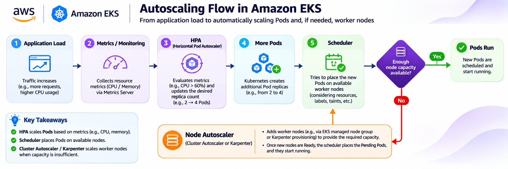
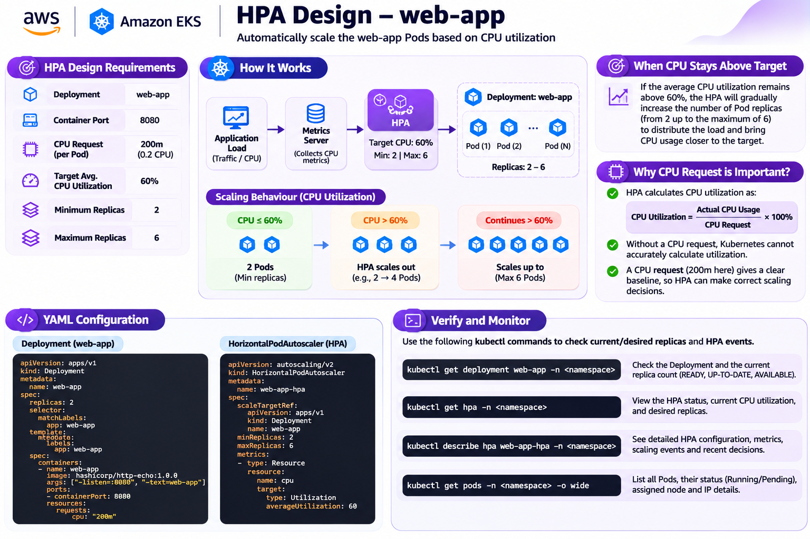

# Day 42 – AWS EKS: Autoscaling

## Overview

Day 42 focuses on autoscaling in Amazon Elastic Kubernetes Service (EKS).

Autoscaling allows Kubernetes applications and infrastructure to adjust their capacity according to workload requirements.

When application traffic increases, Kubernetes may need additional Pods to handle the workload. If the existing worker nodes do not have enough CPU or memory, additional worker-node capacity may also be required.

EKS autoscaling involves different mechanisms that solve different scaling problems:

- Horizontal Pod Autoscaler (HPA).
- Cluster Autoscaler.
- Karpenter.
- Metrics Server.
- Kubernetes resource requests.
- EKS Managed Node Groups.

This day covers how these components work together to scale application Pods and worker-node capacity.

### Learning Objectives

- Understand why Pods and worker nodes need different scaling mechanisms.
- Differentiate HPA, Cluster Autoscaler and Karpenter.
- Understand resource requests, Metrics Server and Kubernetes scheduling.
- Explain how EKS Managed Node Groups provide worker capacity.
- Identify common autoscaling failures and cost risks.

---

# 1. Core Concepts – Kubernetes Autoscaling

## 1.1 What Is Autoscaling?

Autoscaling is the process of automatically increasing or decreasing computing resources according to workload requirements.

For example:

- When application traffic increases, more Pods may be required.
- When CPU utilization increases, HPA can increase the number of Pod replicas.
- When existing worker nodes do not have enough capacity, node autoscaling can provide additional worker nodes.
- When demand decreases, autoscaling mechanisms may reduce unnecessary capacity.

Autoscaling helps applications handle changing workloads while making efficient use of available infrastructure.

## 1.2 Types of Kubernetes Autoscaling

There are three important autoscaling mechanisms in this exercise.

| Autoscaler | What It Scales | Main Purpose |
|---|---|---|
| HPA | Pod replicas | Scale application workloads |
| Cluster Autoscaler | Worker-node count in configured node groups | Add or remove worker nodes |
| Karpenter | Compute capacity | Provision suitable worker capacity based on Pod requirements |

Remember:

- HPA scales Pods.
- Cluster Autoscaler scales configured node groups.
- Karpenter provisions and deprovisions compute capacity.

## 1.3 Horizontal Pod Autoscaler (HPA)

HPA stands for Horizontal Pod Autoscaler.

It automatically increases or decreases the number of Pod replicas based on observed metrics.

Common metrics include:

- CPU utilization.
- Memory utilization.
- Other supported custom or external metrics.

Example:

Suppose a web application initially has two Pods.

When average CPU utilization remains above the configured target, HPA calculates a higher desired replica count.

The number of Pods can increase from 2 to 3, 4, or more, subject to the configured maximum.

Key characteristics:

- Scales application Pods horizontally.
- Uses resource metrics such as CPU or memory.
- Requires metrics to calculate resource utilization.
- Uses minimum and maximum replica limits.
- Works with Kubernetes Deployments and other scalable workloads.

## 1.4 Cluster Autoscaler

Cluster Autoscaler automatically adjusts the size of configured node groups when Pods cannot be scheduled because available capacity is insufficient.

For Amazon EKS, Cluster Autoscaler can interact with EKS Managed Node Groups.

Example:

- A node group currently has two worker nodes.
- HPA increases the number of application Pods.
- The existing nodes do not have enough CPU or memory.
- Some Pods remain Pending.
- Cluster Autoscaler can increase the node-group size within its configured limits.

Key characteristics:

- Scales worker-node capacity.
- Responds to unschedulable Pods.
- Works with configured node groups.
- Uses minimum and maximum node-group limits.
- Can add or remove nodes according to its configuration.

## 1.5 Karpenter

Karpenter is a Kubernetes node provisioning and autoscaling solution.

It evaluates pending Pod requirements and configured provisioning constraints to determine suitable compute capacity.

It can select appropriate instance types and provision worker capacity according to workload requirements.

Key characteristics:

- Provisions compute capacity for pending workloads.
- Evaluates CPU and memory requirements.
- Considers configured instance and scheduling constraints.
- Can provision and deprovision worker capacity.
- Helps provide suitable infrastructure for Kubernetes workloads.

## 1.6 Metrics Server

Metrics Server collects resource usage metrics from Kubernetes nodes and Pods.

These metrics are commonly used by:

- `kubectl top nodes`
- `kubectl top pods`
- Resource-metric HPA.

Metrics Server provides CPU and memory usage information to Kubernetes.

Without available metrics, resource-metric HPA may not be able to calculate utilization correctly.

Useful commands:

```bash
kubectl get deployment metrics-server -n kube-system
kubectl top nodes
kubectl top pods -A
```

## 1.7 Resource Requests

Resource requests specify the amount of CPU or memory requested by a container.

Example:

```yaml
resources:
  requests:
    cpu: 200m
    memory: 64Mi
```

CPU units:

| CPU Value | Meaning |
|---|---|
| 1000m | 1 CPU core |
| 500m | 0.5 CPU core |
| 200m | 0.2 CPU core |
| 100m | 0.1 CPU core |

Resource requests are important for:

- Kubernetes Pod scheduling.
- CPU utilization calculations used by HPA.
- Determining whether a worker node has enough available capacity.

For CPU utilization-based HPA, the CPU request provides the baseline against which actual CPU usage is measured.

---

# 2. HPA vs Cluster Autoscaler vs Karpenter

## 2.1 Comparison Table

| Feature | HPA | Cluster Autoscaler | Karpenter |
|---|---|---|---|
| Full name | Horizontal Pod Autoscaler | Cluster Autoscaler | Karpenter |
| What it scales | Pod replicas | Node-group size | Compute capacity |
| Main trigger | Resource metrics | Unschedulable Pods | Pending Pod requirements |
| CPU and memory metrics | Uses metrics for resource-based scaling | Not the primary scaling trigger | Evaluates Pod resource requirements |
| Main purpose | Scale application workloads | Increase or decrease configured node groups | Provision suitable compute capacity |
| AWS infrastructure impact | Does not directly create EC2 instances | Can launch or terminate EC2 instances | Can launch or terminate EC2 instances |

## 2.2 Why HPA and Node Autoscaling Are Different

HPA and node autoscaling solve different problems.

HPA increases the number of application Pods.

However, creating more Pods does not guarantee that enough worker nodes exist to run them.

If existing nodes lack CPU or memory, new Pods may remain Pending.

Cluster Autoscaler or Karpenter can provide additional worker-node capacity when configured appropriately.

## 2.3 Why Can HPA Increase Replicas While Pods Remain Pending?

Example:

- The application initially has two Pods.
- CPU utilization remains above the HPA target.
- HPA increases the desired replica count to four.
- Kubernetes creates two additional Pods.
- Existing worker nodes do not have enough capacity.
- The additional Pods remain Pending.

The HPA has increased the desired Pod count, but the Kubernetes scheduler cannot find suitable worker-node capacity.

Node autoscaling can help provide additional capacity.

---

# 3. Autoscaling Architecture and Flow



## 3.1 End-to-End Autoscaling Flow

The general workflow is:

**Application Load → Metrics Server → HPA → More Pods → Kubernetes Scheduler → Node Autoscaler if Capacity Is Missing**

### Step 1: Application Load Increases

Application traffic increases.

For example:

- More incoming requests.
- Higher CPU usage.
- Increased workload demand.

### Step 2: Metrics Server Collects Metrics

Metrics Server collects CPU and memory usage information from Kubernetes nodes and Pods.

These metrics are used by resource-metric HPA.

### Step 3: HPA Evaluates Metrics

HPA compares the observed metrics with the configured target.

If average CPU utilization remains above the target, HPA can increase the desired replica count.

### Step 4: Kubernetes Creates More Pods

The Deployment controller creates additional Pod replicas according to the desired replica count.

### Step 5: Kubernetes Scheduler Places Pods

The scheduler attempts to place the new Pods on available worker nodes.

It considers:

- CPU and memory availability.
- Node selectors.
- Taints and tolerations.
- Affinity rules.
- Storage and topology constraints.

### Step 6: Node Autoscaler Provides Capacity if Needed

If suitable worker-node capacity is unavailable, Cluster Autoscaler or Karpenter may provide additional compute capacity.

After new nodes become Ready, the scheduler can place the Pending Pods.

### Important Concept

HPA scales Pods, while Cluster Autoscaler and Karpenter scale worker-node capacity.

---

# 4. Task A – Compare the Autoscalers

The objective is to compare HPA, Cluster Autoscaler and Karpenter.

## HPA

- Scales Pod replicas.
- Uses CPU, memory or other supported metrics.
- Requires metrics for resource-based utilization scaling.
- Uses minimum and maximum replica limits.

## Cluster Autoscaler

- Adjusts configured node-group size.
- Responds to unschedulable Pods.
- Interacts with EKS Managed Node Groups.
- Operates within configured minimum and maximum node counts.

## Karpenter

- Provisions and deprovisions compute capacity.
- Evaluates pending Pod resource requirements.
- Selects capacity according to configured constraints.
- Can provision suitable worker nodes for workloads.

## Why HPA-Created Pods May Remain Pending

HPA can increase the desired replica count even if the existing worker nodes cannot accommodate the additional Pods.

Possible reasons:

- Insufficient CPU.
- Insufficient memory.
- Node selector mismatch.
- Untolerated node taints.
- Affinity constraints.
- PVC or Availability Zone constraints.

Node autoscaling can provide additional capacity if it is correctly configured.

---

# 5. Task B – Inspect Cluster Metrics (Read-only)

This task uses Kubernetes commands to inspect nodes, Pods, resource metrics and existing HPAs.

For practice, a local Minikube cluster can be used instead of a real AWS EKS cluster.

## 5.1 Check the Kubernetes Context

```bash
kubectl config current-context
```

For local practice, the expected context is:

```text
minikube
```

If necessary, switch to Minikube:

```bash
kubectl config use-context minikube
```

## 5.2 Check Nodes

```bash
kubectl get nodes
```

This command displays the Kubernetes nodes and their status.

## 5.3 Check Pods Across Namespaces

```bash
kubectl get pods -A
```

This displays Pods across all namespaces.

## 5.4 Check Node Metrics

```bash
kubectl top nodes
```

This displays CPU and memory usage for Kubernetes nodes.

## 5.5 Check Pod Metrics

```bash
kubectl top pods -A
```

This displays CPU and memory usage for Pods.

## 5.6 Check Existing HPAs

```bash
kubectl get hpa -A
```

This lists Horizontal Pod Autoscalers across namespaces.

If no HPA exists, Kubernetes may display:

```text
No resources found
```

This is normal if no HPA has been created.

## 5.7 Check Metrics Server

If `kubectl top` reports unavailable metrics, inspect Metrics Server:

```bash
kubectl get deployment metrics-server -n kube-system
```

For Minikube, if Metrics Server is missing, enable the local addon:

```bash
minikube addons enable metrics-server
```

Verify:

```bash
kubectl get pods -n kube-system
kubectl top nodes
```

Wait for Metrics Server to become healthy before retrying metric commands.

## 5.8 Describe an HPA

If an HPA exists:

```bash
kubectl describe hpa HPA_NAME -n NAMESPACE
```

This shows:

- HPA target.
- Current metrics.
- Desired replicas.
- Minimum and maximum replicas.
- Scaling conditions.
- Events and errors.

## 5.9 Inspect Recent Events

```bash
kubectl get events -A --sort-by=.lastTimestamp
```

This helps identify scheduling, scaling and metrics-related issues.

---

# 6. Task C – Design an HPA

The PDF specifies the following HPA design.

## 6.1 HPA Requirements

| Parameter | Required Value |
|---|---|
| Deployment | `web-app` |
| Container port | `8080` |
| CPU request per Pod | `200m` |
| Target average CPU utilization | `60%` |
| Minimum replicas | `2` |
| Maximum replicas | `6` |



## 6.2 Understanding the CPU Request

Each Pod has a CPU request of:

`200m`

This means:

`200m = 0.2 CPU core`

The HPA target is:

`60%`

For a Pod requesting 200m CPU:

```text
Target CPU usage = CPU request × Target utilization

Target CPU usage = 200m × 60%

Target CPU usage = 120m
```

The target average CPU usage is 120m per Pod.

## 6.3 Why Is CPU Request Important?

CPU utilization-based HPA calculates utilization relative to the CPU request.

Conceptually:

```text
CPU Utilization =
(Actual CPU Usage / CPU Request) × 100
```

Without a CPU request for the relevant container, Kubernetes cannot correctly calculate the requested CPU utilization percentage for that container.

A CPU request provides a clear baseline for HPA scaling decisions.

## 6.4 Create the Deployment

Create a file:

```bash
nano web-app.yaml
```

Add:

```yaml
apiVersion: apps/v1
kind: Deployment
metadata:
  name: web-app
spec:
  replicas: 2
  selector:
    matchLabels:
      app: web-app
  template:
    metadata:
      labels:
        app: web-app
    spec:
      containers:
        - name: web-app
          image: hashicorp/http-echo:1.0.0
          args:
            - "-listen=:8080"
            - "-text=Hello from Day 42 web-app"
          ports:
            - containerPort: 8080
          resources:
            requests:
              cpu: 200m
              memory: 64Mi
```

This example uses a sample HTTP echo container for local practice.

The Deployment:

- Is named `web-app`.
- Starts with two replicas.
- Uses port 8080.
- Requests 200m CPU per Pod.
- Requests 64Mi memory per Pod.

Apply:

```bash
kubectl apply -f web-app.yaml
```

Verify:

```bash
kubectl get deployment web-app
kubectl get pods -l app=web-app
```

## 6.5 Create the HPA

Create a file:

```bash
nano web-app-hpa.yaml
```

Add:

```yaml
apiVersion: autoscaling/v2
kind: HorizontalPodAutoscaler
metadata:
  name: web-app-hpa
spec:
  scaleTargetRef:
    apiVersion: apps/v1
    kind: Deployment
    name: web-app
  minReplicas: 2
  maxReplicas: 6
  metrics:
    - type: Resource
      resource:
        name: cpu
        target:
          type: Utilization
          averageUtilization: 60
```

Apply:

```bash
kubectl apply -f web-app-hpa.yaml
```

## 6.6 Verify the HPA

Check the HPA:

```bash
kubectl get hpa -n NAMESPACE
```

Check Deployment status:

```bash
kubectl get deployment web-app -n NAMESPACE
```

Describe HPA details:

```bash
kubectl describe hpa web-app-hpa -n NAMESPACE
```

Check Pod placement:

```bash
kubectl get pods -n NAMESPACE -o wide
```

Check CPU metrics:

```bash
kubectl top pods -n NAMESPACE
```

Replace `NAMESPACE` with the actual namespace. If the Deployment and HPA were created in the default namespace, use `default`.

## 6.7 What Happens When Average CPU Remains Above Target?

If average CPU utilization remains above 60%:

1. Metrics Server provides CPU usage metrics.
2. HPA evaluates current utilization against the 60% target.
3. HPA calculates the desired replica count.
4. The Deployment controller creates additional Pods.
5. Kubernetes scheduler attempts to place the new Pods.
6. If existing worker nodes lack capacity, Pods may remain Pending.
7. A configured node autoscaler may provide additional capacity.

HPA scales gradually according to its algorithm and scaling behavior. It does not necessarily increase replicas immediately when CPU briefly exceeds the target.

## 6.8 HPA Scaling Limits

| Setting | Value |
|---|---:|
| Minimum replicas | 2 |
| Maximum replicas | 6 |
| CPU target | 60% |
| CPU request per Pod | 200m |
| Target CPU usage per Pod | 120m |

Possible replica counts:

`2 → 3 → 4 → 5 → 6`

The HPA will not exceed the configured maximum of six replicas.

---

# 7. Task D – Understand Node Autoscaling

## 7.1 Why Can a Pod Remain Pending?

A Pod may remain Pending after HPA increases replicas because Kubernetes cannot find a suitable worker node.

Common causes:

- Insufficient CPU.
- Insufficient memory.
- Node selector requirements cannot be satisfied.
- Taints are not tolerated.
- Affinity rules prevent scheduling.
- PVC or Availability Zone constraints prevent volume attachment.

## 7.2 Insufficient CPU or Memory

Worker nodes have limited CPU and memory resources.

When existing nodes do not have enough available capacity, Kubernetes cannot schedule additional Pods.

Inspect:

```bash
kubectl describe nodes
```

Check Pod scheduling events:

```bash
kubectl describe pod POD_NAME -n NAMESPACE
```

## 7.3 Node Selectors

Node selectors restrict which nodes can run a Pod.

If no node has the required label, the Pod may remain Pending.

Inspect node labels:

```bash
kubectl get nodes --show-labels
```

## 7.4 Taints and Tolerations

Taints prevent Pods from scheduling on nodes unless they have matching tolerations.

A Pod without the required toleration may not be scheduled on a tainted node.

Inspect:

```bash
kubectl describe nodes
```

## 7.5 Affinity and Anti-Affinity

Affinity and anti-affinity rules control Pod placement based on node or other Pod characteristics.

If the scheduling rules cannot be satisfied, the Pod may remain Pending.

Inspect:

```bash
kubectl describe pod POD_NAME -n NAMESPACE
```

## 7.6 PVC and Availability Zone Constraints

Storage can also affect scheduling.

For example:

- An EBS volume exists in one Availability Zone.
- A Pod is scheduled to a worker node in another Availability Zone.
- The volume cannot attach to that worker node.

Kubernetes must find a compatible node and storage placement.

## 7.7 How Cluster Autoscaler Works with EKS Managed Node Groups

EKS Managed Node Groups provide EC2 worker nodes for Kubernetes workloads.

Example configuration:

| Setting | Example |
|---|---:|
| Minimum nodes | 2 |
| Desired nodes | 2 |
| Maximum nodes | 5 |

If Pods cannot be scheduled because of insufficient capacity, Cluster Autoscaler can increase the managed node group's size.

It operates within configured minimum and maximum limits.

These values are illustrative and should not be applied to AWS without approval.

## 7.8 How Karpenter Works

Karpenter evaluates pending Pod requirements and configured provisioning constraints.

It can:

- Evaluate CPU and memory requirements.
- Select suitable instance capacity.
- Consider configured scheduling constraints.
- Provision additional worker capacity.
- Deprovision capacity when appropriate.

## 7.9 Why Should Two Autoscalers Not Manage the Same Capacity Pool?

If Cluster Autoscaler and Karpenter both attempt to manage the same capacity pool, their scaling decisions may conflict.

Possible consequences:

- Unnecessary worker nodes.
- Unpredictable scaling.
- Conflicting capacity decisions.
- Unexpected AWS charges.

A deliberate architecture should define which autoscaler manages each capacity pool.

## 7.10 Useful Troubleshooting Commands

```bash
kubectl get pods -A -o wide
kubectl describe pod POD_NAME -n NAMESPACE
kubectl get nodes --show-labels
kubectl describe nodes
kubectl get events -A --sort-by=.lastTimestamp
```

---

# 8. Task E – Optional AWS/EKS Lab (Approval Required)

This task should only use an existing approved EKS cluster.

Autoscaling may launch EC2 instances and increase AWS charges.

Without approval, complete the design and read-only inspection tasks.

## 8.1 Inspect Existing Node Groups

List node groups:

```bash
aws eks list-nodegroups \
  --cluster-name CLUSTER_NAME \
  --region REGION
```

Inspect node-group scaling configuration:

```bash
aws eks describe-nodegroup \
  --cluster-name CLUSTER_NAME \
  --nodegroup-name NODEGROUP_NAME \
  --region REGION \
  --query "nodegroup.scalingConfig"
```

This shows:

- Minimum node count.
- Maximum node count.
- Desired node count.

## 8.2 Check Whether Cluster Autoscaler or Karpenter Is Installed

```bash
kubectl get pods -A | grep -Ei 'cluster-autoscaler|karpenter'
```

Inspect deployments:

```bash
kubectl get deployments -A | grep -Ei 'cluster-autoscaler|karpenter'
```

Do not install another autoscaler without checking the existing architecture.

## 8.3 Check Workload Resource Requests

```bash
kubectl describe deployment web-app
```

Confirm that the CPU request is configured correctly.

## 8.4 Confirm Metrics Availability

```bash
kubectl top nodes
kubectl top pods -A
kubectl get hpa -A
```

## 8.5 Optional Approved Scaling Lab

With explicit approval and an existing approved EKS cluster:

1. Inspect current node-group minimum and maximum sizes.
2. Check whether Cluster Autoscaler or Karpenter is already installed.
3. Confirm workload resource requests.
4. Verify Metrics Server availability.
5. Deploy a small test workload.
6. Observe HPA under controlled load.
7. If worker capacity is insufficient, observe the configured node autoscaler.
8. Verify that new nodes become Ready.
9. Remove only the test workload.
10. Restore node-group settings to the approved baseline.

## 8.6 Cost and Safety Considerations

Potential AWS charges include:

- EKS cluster resources.
- EC2 worker nodes.
- EBS volumes.
- Load balancers.
- NAT Gateway.
- Public IPv4 addresses.
- Data transfer.

AWS Budgets alerts are not a hard spending cap.

Do not:

- Increase node-group limits without approval.
- Install autoscalers on real EKS without approval.
- Generate load on AWS without approval.
- Delete shared or production infrastructure.
- Leave unnecessary worker nodes running.

Prefer Minikube for practical exercises.

---

# 9. Troubleshooting

## 9.1 HPA Shows Unknown Metrics

Possible causes:

- Metrics Server is missing.
- Metrics Server is unhealthy.
- Kubernetes metrics API is unavailable.
- Required CPU requests are missing.
- Resource metrics are not yet available.

Check:

```bash
kubectl get deployment metrics-server -n kube-system
kubectl get pods -n kube-system
kubectl top nodes
kubectl top pods -A
```

## 9.2 Replicas Do Not Increase

Possible causes:

- CPU utilization is below the configured target.
- Metrics are unavailable.
- HPA maximum replicas have been reached.
- CPU requests are missing.
- The workload is not receiving enough load.

Check:

```bash
kubectl get hpa -A
kubectl describe hpa HPA_NAME -n NAMESPACE
kubectl get deployment web-app -n NAMESPACE
```

## 9.3 Pods Remain Pending

Possible causes:

- Insufficient CPU.
- Insufficient memory.
- Node selector mismatch.
- Untolerated taints.
- Affinity restrictions.
- PVC or Availability Zone constraints.

Check:

```bash
kubectl get pods -A -o wide
kubectl describe pod POD_NAME -n NAMESPACE
kubectl describe nodes
kubectl get events -A --sort-by=.lastTimestamp
```

## 9.4 Nodes Do Not Scale

Possible causes:

- Autoscaler is not installed.
- Node-group minimum or maximum limits prevent scaling.
- IAM permissions are insufficient.
- Node-group discovery tags are missing or incorrect.
- EC2 instance capacity is unavailable.
- Autoscaler configuration is incorrect.

Check the configured autoscaler and its logs before making changes.

## 9.5 Unexpected Cost Increase

Possible causes:

- More EC2 worker nodes than expected.
- Large instance types.
- Node-group maximum settings too high.
- Test workloads left running.
- Additional AWS resources created during the lab.

Inspect node count and instance types.

Stop the lab safely and restore approved baseline settings.

---

# 10. Important Commands – Quick Reference

```bash
# Check current Kubernetes context
kubectl config current-context

# List Kubernetes nodes
kubectl get nodes

# List Pods
kubectl get pods -A

# Check node CPU and memory
kubectl top nodes

# Check Pod CPU and memory
kubectl top pods -A

# List HPAs
kubectl get hpa -A

# Check Metrics Server
kubectl get deployment metrics-server -n kube-system

# Describe an HPA
kubectl describe hpa HPA_NAME -n NAMESPACE

# Inspect Deployment replicas
kubectl get deployment web-app -n NAMESPACE

# Inspect Pod placement
kubectl get pods -n NAMESPACE -o wide

# Inspect node labels
kubectl get nodes --show-labels

# Describe nodes
kubectl describe nodes

# Describe a Pod
kubectl describe pod POD_NAME -n NAMESPACE

# Check recent events
kubectl get events -A --sort-by=.lastTimestamp

# List EKS node groups
aws eks list-nodegroups \
  --cluster-name CLUSTER_NAME \
  --region REGION

# Inspect EKS node-group scaling settings
aws eks describe-nodegroup \
  --cluster-name CLUSTER_NAME \
  --nodegroup-name NODEGROUP_NAME \
  --region REGION \
  --query "nodegroup.scalingConfig"
```

---

# 11. Interview Questions and Answers

### Q1. What is Kubernetes autoscaling?

Autoscaling automatically adjusts application or infrastructure capacity according to workload requirements.

### Q2. What is HPA?

HPA stands for Horizontal Pod Autoscaler. It automatically increases or decreases Pod replicas based on metrics such as CPU or memory.

### Q3. What does Cluster Autoscaler do?

Cluster Autoscaler adjusts the size of configured node groups when Pods cannot be scheduled because of insufficient worker-node capacity.

### Q4. What is Karpenter?

Karpenter is a Kubernetes node provisioning solution that selects and provisions compute capacity based on pending Pod requirements and configured constraints.

### Q5. What is the difference between HPA and Cluster Autoscaler?

HPA scales application Pod replicas, whereas Cluster Autoscaler scales worker-node capacity within configured node groups.

### Q6. What is Metrics Server?

Metrics Server collects CPU and memory usage metrics from Kubernetes nodes and Pods. These metrics are commonly used by `kubectl top` and resource-metric HPA.

### Q7. Why are resource requests important?

Resource requests help Kubernetes schedule Pods and provide the baseline for CPU utilization calculations used by HPA.

### Q8. Why can HPA-created Pods remain Pending?

HPA can increase the desired replica count, but existing worker nodes may not have enough CPU or memory to run the additional Pods.

### Q9. How does node autoscaling solve this problem?

Cluster Autoscaler or Karpenter can provide additional worker-node capacity so that Pending Pods can be scheduled.

### Q10. What happens when CPU utilization remains above the HPA target?

HPA calculates a higher desired replica count and increases the number of Pods, subject to the configured minimum and maximum limits.

### Q11. Why does HPA need CPU requests?

CPU utilization is calculated relative to the requested CPU. Without a CPU request for the relevant container, utilization cannot be calculated correctly.

### Q12. What is the purpose of minimum and maximum replicas?

Minimum replicas define the lowest number of Pods HPA can maintain. Maximum replicas define the highest number of Pods HPA can request.

### Q13. Why should two autoscalers not manage the same capacity pool?

They may make conflicting scaling decisions, causing unpredictable behavior and unnecessary infrastructure costs.

### Q14. What should you check when HPA reports unknown metrics?

Check Metrics Server health, metrics API availability, CPU requests and Kubernetes events.

### Q15. How can autoscaling affect AWS costs?

Node autoscaling can launch additional EC2 instances. More worker nodes and associated infrastructure increase AWS charges.

---

# 12. Key Takeaways

- Autoscaling adjusts Kubernetes application and infrastructure capacity.
- HPA scales Pod replicas.
- Cluster Autoscaler adjusts configured node-group size.
- Karpenter provisions and deprovisions compute capacity.
- Metrics Server provides CPU and memory metrics.
- Resource requests are important for scheduling and HPA utilization calculations.
- HPA may increase replicas while Pods remain Pending.
- Node autoscaling can provide additional worker-node capacity.
- EKS Managed Node Groups provide EC2 worker nodes.
- Node-group minimum and maximum limits control scaling boundaries.
- Node selectors, taints, tolerations, affinity and storage constraints can prevent Pod scheduling.
- Multiple autoscalers should not manage the same capacity pool without a deliberate design.
- Autoscaling on AWS can increase infrastructure charges.
- Minikube is suitable for local autoscaling practice.

---

# 13. Day 42 Completion Summary

Day 42 builds an understanding of application autoscaling and worker-node autoscaling in Amazon EKS.

The most important concept is understanding that increasing Pod replicas does not automatically provide additional worker-node capacity.

HPA handles application Pod scaling, while Cluster Autoscaler and Karpenter handle worker-node capacity through different approaches.

The practical exercise uses a web application with:

- Deployment: `web-app`
- Container port: `8080`
- CPU request: `200m`
- CPU target: `60%`
- Minimum replicas: `2`
- Maximum replicas: `6`

The day also develops the ability to inspect metrics, troubleshoot Pending Pods, understand node-group scaling, and identify AWS autoscaling cost risks.

**Main concept to remember:**

- HPA = Scale Pods.
- Cluster Autoscaler = Scale configured node groups.
- Karpenter = Provision suitable compute capacity.
- Metrics Server = Provide CPU and memory metrics.
- Resource Requests = Help scheduling and HPA utilization calculations.
