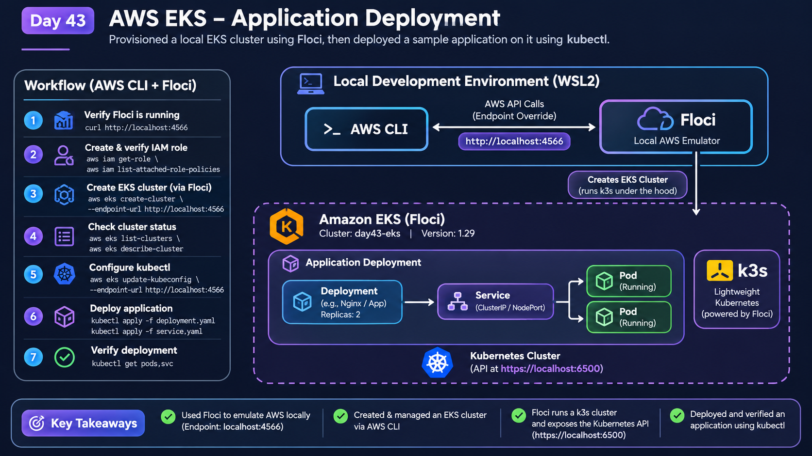

# Day 43/90 – Deploy an Application on AWS EKS

## AWS Week – Kubernetes Application Deployment Using Floci

**Focus:** AWS CLI · Amazon EKS · Floci · Kubernetes · Deployment · Service · kubectl · Nginx

**Environment:** Ubuntu on WSL2 · Docker · Floci 2.3.0 · AWS CLI v2 · Kubernetes (k3s)

---

## Today's Mission

The objective of Day 43 was to understand how to deploy a containerized application on an AWS EKS cluster using Kubernetes.

The practical task was to create an EKS cluster, connect to it using `kubectl`, deploy an Nginx web application with two replicas, expose it internally using a ClusterIP Service, and verify Kubernetes self-healing.

Instead of creating billable resources in real AWS, I used **Floci**, a local AWS cloud emulator.

Floci provides an EKS-compatible API and runs a local k3s Kubernetes cluster behind the simulated EKS service.

> **Important:** This is a local Floci-based EKS simulation, not a real AWS-managed EKS control plane or actual EC2 worker nodes.

---

# Part 1 – Key Concepts

## 1. What is Amazon EKS?

Amazon Elastic Kubernetes Service (EKS) is a managed Kubernetes service provided by AWS.

It allows users to run and manage containerized applications using Kubernetes without manually managing the Kubernetes control plane.

### Main components

- **EKS Control Plane:** Manages Kubernetes API operations, scheduling, and cluster state.
- **Worker Nodes:** Run application Pods.
- **Pod:** The smallest deployable unit in Kubernetes.
- **Deployment:** Manages replicas and ensures the desired number of Pods are running.
- **Service:** Provides a stable network endpoint to access application Pods.
- **kubectl:** Command-line tool used to communicate with the Kubernetes API.

## 2. What is Floci?

Floci is a local AWS cloud emulator that allows developers to practise AWS service workflows without creating corresponding real AWS infrastructure.

For this practical:

- Floci provided the simulated AWS EKS API.
- AWS CLI communicated with Floci instead of AWS.
- Floci created a local k3s Kubernetes cluster.
- The Kubernetes API was exposed through a local HTTPS endpoint.
- kubectl communicated with that Kubernetes API.

### Architecture



```text
                 Ubuntu WSL2
                      |
                      |
                  AWS CLI
                      |
                      | AWS API requests
                      v
             Floci AWS Emulator
             localhost:4566
                      |
                      |
                 EKS Service
                      |
                      | CreateCluster
                      v
             Local k3s Container
             floci-aws-eks-day43-eks
                      |
                      |
             Kubernetes API
             localhost:6500
                      |
                      |
                   kubectl
                      |
                      v
             Kubernetes Cluster
                      |
               +------+------+
               |             |
               v             v
            Nginx Pod     Nginx Pod
               |             |
               +------+------+
                      |
                      v
              ClusterIP Service
                  day43-web
```

---

# Part 2 – Environment Preparation

## 1. Verify AWS CLI

Check the installed AWS CLI version:

```bash
aws --version
```

Output:

```text
aws-cli/2.31.35 Python/3.14.4 Linux/6.18.58.1-microsoft-standard-WSL2 source/x86_64.ubuntu.26
```

The official AWS CLI v2 installer was used to install/update the CLI.

Installation commands:

```bash
sudo apt update
sudo apt install -y curl unzip

curl "https://awscli.amazonaws.com/awscli-exe-linux-x86_64.zip" \
  -o "awscliv2.zip"

unzip -o awscliv2.zip

sudo ./aws/install --update
```

Verify:

```bash
which aws
aws --version
```

Expected executable location:

```text
/usr/local/bin/aws
```

## 2. Verify Floci

Start Floci if it is not already running:

```bash
floci start
```

Check its status:

```bash
floci status
```

Expected status:

```text
Container:  floci  running
Endpoint:   http://localhost:4566
Reachable:  yes
Version:    2.3.0
```

Check the Floci endpoint:

```bash
curl -s http://localhost:4566/
```

A successful XML response confirms that the endpoint is reachable.

## 3. Configure AWS CLI to use Floci

Set the environment variables:

```bash
export AWS_ENDPOINT_URL=http://localhost:4566
export AWS_DEFAULT_REGION=us-east-1
export AWS_ACCESS_KEY_ID=test
export AWS_SECRET_ACCESS_KEY=test
```

Explanation:

| Variable | Purpose |
|---|---|
| AWS_ENDPOINT_URL | Sends AWS CLI requests to Floci |
| AWS_DEFAULT_REGION | Sets the default AWS region |
| AWS_ACCESS_KEY_ID | Local emulator credentials |
| AWS_SECRET_ACCESS_KEY | Local emulator secret |

**Important:** These initial `test/test` credentials are for ordinary Floci AWS API operations. They are not suitable for Floci's EKS Kubernetes cluster-admin authentication.

---

# Part 3 – Create the EKS IAM Cluster Role

Before creating the simulated EKS cluster, I created an IAM role for the EKS service.

## 1. Create the trust policy

Create the file:

```bash
nano eks-trust-policy.json
```

Add:

```json
{
  "Version": "2012-10-17",
  "Statement": [
    {
      "Effect": "Allow",
      "Principal": {
        "Service": "eks.amazonaws.com"
      },
      "Action": "sts:AssumeRole"
    }
  ]
}
```

Save the file.

## 2. Create the IAM role

```bash
aws iam create-role \
  --role-name floci-eks-cluster-role \
  --assume-role-policy-document file://eks-trust-policy.json
```

The role ARN returned was:

```text
arn:aws:iam::000000000000:role/floci-eks-cluster-role
```

## 3. Attach the EKS cluster policy

```bash
aws iam attach-role-policy \
  --role-name floci-eks-cluster-role \
  --policy-arn arn:aws:iam::aws:policy/AmazonEKSClusterPolicy
```

## 4. Verify the IAM role

```bash
aws iam get-role \
  --role-name floci-eks-cluster-role
```

Check the attached policies:

```bash
aws iam list-attached-role-policies \
  --role-name floci-eks-cluster-role
```

Expected policy:

```text
AmazonEKSClusterPolicy
```

### Why is this role needed?

The EKS cluster IAM role represents the permissions and identity used by the EKS service when managing the cluster.

It is different from the IAM identity used by an administrator to authenticate to Kubernetes.

---

# Part 4 – Create the EKS Cluster Using Floci

## 1. Initial cluster creation attempt

Initially, I attempted to create the cluster using:

```bash
aws eks create-cluster \
  --name day43-eks \
  --role-arn arn:aws:iam::000000000000:role/floci-eks-cluster-role \
  --resources-vpc-config subnetIds=subnet-default-us-east-1-a \
  --version 1.29
```

However, the cluster was not registered in Floci.

I verified:

```bash
aws eks list-clusters --region us-east-1
```

Output:

```json
{
    "clusters": []
}
```

The problem was the VPC configuration format used in the request.

## 2. Correct cluster creation command

I then used Floci's minimal supported VPC configuration format:

```bash
aws --endpoint-url http://localhost:4566 eks create-cluster \
  --region us-east-1 \
  --name day43-eks \
  --role-arn arn:aws:iam::000000000000:role/floci-eks-cluster-role \
  --resources-vpc-config '{}'
```

This successfully created the cluster.

Important configuration:

| Setting | Value |
|---|---|
| Cluster name | day43-eks |
| Region | us-east-1 |
| Kubernetes version | 1.29 |
| IAM role | floci-eks-cluster-role |
| VPC configuration | Empty JSON object |
| Local Kubernetes implementation | k3s |
| Local Kubernetes API endpoint | https://localhost:6500 |

## 3. Verify the cluster

List clusters:

```bash
aws --endpoint-url http://localhost:4566 eks list-clusters \
  --region us-east-1
```

Expected:

```json
{
    "clusters": [
        "day43-eks"
    ]
}
```

Describe the cluster:

```bash
aws --endpoint-url http://localhost:4566 eks describe-cluster \
  --name day43-eks \
  --region us-east-1
```

The cluster eventually reached:

```json
{
    "cluster": {
        "name": "day43-eks",
        "version": "1.29",
        "endpoint": "https://localhost:6500",
        "status": "ACTIVE"
    }
}
```

## 4. Verify the local k3s container

Run:

```bash
docker ps -a --filter "name=floci-aws-eks-day43-eks"
```

The container created was:

```text
floci-aws-eks-day43-eks
```

The port mapping was:

```text
6500 -> 6443
```

This means the Kubernetes API running inside the k3s container is accessible through port 6500 on the local machine.

### Important learning

Floci's EKS real mode uses a local k3s container to provide a working Kubernetes API.

It simulates the EKS API workflow but does not create actual AWS EC2 instances, subnets, or an AWS-managed EKS control plane.

---

# Part 5 – Configure Kubernetes Access

Creating the EKS cluster and authenticating to its Kubernetes API are separate operations.

The initial `test/test` credentials are not accepted for Kubernetes cluster-admin authentication.

Therefore, I created a simulated IAM user and access key in Floci.

## 1. Create an IAM user

```bash
aws iam create-user \
  --user-name day43-eks-admin
```

## 2. Generate an access key

```bash
aws iam create-access-key \
  --user-name day43-eks-admin
```

The response contains:

- AccessKeyId
- SecretAccessKey

These credentials are simulated Floci credentials, not real AWS account credentials.

## 3. Export the generated credentials

Replace the placeholders with the generated values:

```bash
export AWS_ACCESS_KEY_ID="YOUR_ACCESS_KEY_ID"
export AWS_SECRET_ACCESS_KEY="YOUR_SECRET_ACCESS_KEY"

export AWS_ENDPOINT_URL=http://localhost:4566
export AWS_DEFAULT_REGION=us-east-1
```

Do not share the secret access key or commit it to GitHub.

## 4. Configure kubeconfig

Run:

```bash
aws eks update-kubeconfig \
  --region us-east-1 \
  --name day43-eks \
  --endpoint-url http://localhost:4566
```

This updates the local kubeconfig file so that kubectl knows which cluster to contact and how to obtain authentication credentials.

## 5. Verify the Kubernetes context

```bash
kubectl config current-context
```

Check cluster nodes:

```bash
kubectl get nodes -o wide
```

Expected: the Floci k3s node should report `Ready`.

---

# Part 6 – Deploy the Nginx Application

## Scenario

Deploy a simple Nginx web application with two replicas.

Requirements:

- Two application replicas.
- Nginx container image.
- CPU and memory requests and limits.
- Readiness and liveness probes.
- Internal application exposure using a ClusterIP Service.

## 1. Create the Deployment YAML

Create:

```bash
nano day43-web-deployment.yaml
```

Add:

```yaml
apiVersion: apps/v1
kind: Deployment
metadata:
  name: day43-web
  namespace: default
spec:
  replicas: 2
  selector:
    matchLabels:
      app: day43-web
  template:
    metadata:
      labels:
        app: day43-web
    spec:
      containers:
        - name: nginx
          image: nginx:1.27
          ports:
            - name: http
              containerPort: 80
          resources:
            requests:
              cpu: 100m
              memory: 128Mi
            limits:
              cpu: 300m
              memory: 256Mi
          readinessProbe:
            httpGet:
              path: /
              port: http
            periodSeconds: 5
          livenessProbe:
            httpGet:
              path: /
              port: http
            periodSeconds: 10
```

## 2. Understand the Deployment configuration

| Configuration | Meaning |
|---|---|
| replicas: 2 | Maintains two application Pods |
| image: nginx:1.27 | Uses the Nginx container image |
| containerPort: 80 | Application listens on port 80 |
| cpu: 100m | Requests 0.1 CPU core |
| memory: 128Mi | Requests 128 MiB memory |
| CPU limit: 300m | Maximum CPU allocation |
| Memory limit: 256Mi | Maximum memory allocation |
| readinessProbe | Checks whether the application is ready |
| livenessProbe | Checks whether the application is alive |

## 3. Apply the Deployment

```bash
kubectl apply -f day43-web-deployment.yaml
```

Check rollout:

```bash
kubectl rollout status deployment/day43-web
```

Verify:

```bash
kubectl get deployments
kubectl get pods -o wide
```

Expected: two Nginx Pods should become Running and Ready.

---

# Part 7 – Expose the Application Using ClusterIP

A Kubernetes Service provides a stable network endpoint for accessing a group of Pods.

For this task, I used ClusterIP because the application only needs internal cluster access.

## 1. Create the Service YAML

```bash
nano day43-web-service.yaml
```

Add:

```yaml
apiVersion: v1
kind: Service
metadata:
  name: day43-web
  namespace: default
spec:
  type: ClusterIP
  selector:
    app: day43-web
  ports:
    - name: http
      port: 80
      targetPort: http
```

## 2. Apply the Service

```bash
kubectl apply -f day43-web-service.yaml
```

Verify:

```bash
kubectl get svc day43-web
```

Check the endpoints:

```bash
kubectl get endpoints day43-web
```

The Service selector:

```yaml
selector:
  app: day43-web
```

matches the labels on the Deployment's Pods.

Kubernetes automatically adds matching Pod IP addresses to the Service endpoints.

### Why ClusterIP?

- It exposes the application internally.
- It provides a stable service address.
- It does not create an AWS Load Balancer.
- It is suitable for communication between applications inside the Kubernetes cluster.

---

# Part 8 – Test the Application

A temporary curl Pod can be used to test the internal Service.

Run:

```bash
kubectl run day43-curl \
  --image=curlimages/curl:8.10.1 \
  --restart=Never \
  --rm -it \
  -- curl -I http://day43-web
```

Expected HTTP response:

```text
HTTP/1.1 200 OK
Server: nginx
```

This verifies that:

1. The temporary curl Pod can run.
2. Kubernetes DNS resolves the Service name.
3. The ClusterIP Service forwards traffic to an application Pod.
4. Nginx responds successfully.

---

# Part 9 – Test Kubernetes Self-Healing

A Deployment continuously tries to maintain the desired number of replicas.

If one Pod is deleted, the Deployment controller detects the difference between the desired and actual replica counts and creates a replacement.

## 1. List the application Pods

```bash
kubectl get pods -l app=day43-web
```

## 2. Delete one Pod

Replace `POD_NAME` with an actual Pod name:

```bash
kubectl delete pod POD_NAME
```

## 3. Watch the replacement

```bash
kubectl get pods -w
```

Press `Ctrl+C` after the replacement Pod becomes Ready.

## 4. Verify the desired replica count

```bash
kubectl get deployments
kubectl get pods -l app=day43-web
```

The Deployment should return to two Ready replicas.

### Important learning

Deleting a Pod managed by a Deployment does not permanently reduce the desired replica count.

The Deployment controller creates a replacement to maintain the configured state.

---

# Part 10 – Useful Troubleshooting Commands

## Inspect cluster nodes

```bash
kubectl get nodes -o wide
```

## Inspect Pods

```bash
kubectl get pods -A -o wide
```

## Describe a Deployment

```bash
kubectl describe deployment day43-web
```

## Describe a Service

```bash
kubectl describe service day43-web
```

## Check application logs

```bash
kubectl logs deployment/day43-web
```

## Inspect Service endpoints

```bash
kubectl get endpoints day43-web
```

## Check recent events

```bash
kubectl get events --sort-by=.lastTimestamp
```

## Common issues

| Problem | Possible cause |
|---|---|
| ImagePullBackOff | Image cannot be downloaded |
| Pending | Insufficient node resources or scheduling constraints |
| CrashLoopBackOff | Application repeatedly exits |
| Service has no endpoints | Service selector does not match Pod labels |
| HTTP connection failure | Service, Pod, DNS, or application issue |
| kubectl authentication error | Incorrect credentials or kubeconfig configuration |
| Cluster not found | Cluster creation request was not successfully registered |

---

# Part 11 – Cleanup

Cleanup is important to avoid leaving unnecessary resources running.

## 1. Delete the application Service

```bash
kubectl delete -f day43-web-service.yaml
```

## 2. Delete the Deployment

```bash
kubectl delete -f day43-web-deployment.yaml
```

## 3. Delete the temporary curl Pod

```bash
kubectl delete pod day43-curl --ignore-not-found
```

## 4. Delete the Floci EKS cluster

```bash
aws --endpoint-url http://localhost:4566 eks delete-cluster \
  --name day43-eks \
  --region us-east-1
```

Verify:

```bash
aws --endpoint-url http://localhost:4566 eks list-clusters \
  --region us-east-1
```

Expected:

```json
{
    "clusters": []
}
```

## 5. Remove the simulated IAM access key

List access keys:

```bash
aws --endpoint-url http://localhost:4566 iam list-access-keys \
  --user-name day43-eks-admin
```

Delete the generated key:

```bash
aws --endpoint-url http://localhost:4566 iam delete-access-key \
  --user-name day43-eks-admin \
  --access-key-id YOUR_ACCESS_KEY_ID
```

Delete the user:

```bash
aws --endpoint-url http://localhost:4566 iam delete-user \
  --user-name day43-eks-admin
```

## 6. Remove the cluster IAM role

Detach the policy:

```bash
aws --endpoint-url http://localhost:4566 iam detach-role-policy \
  --role-name floci-eks-cluster-role \
  --policy-arn arn:aws:iam::aws:policy/AmazonEKSClusterPolicy
```

Delete the role:

```bash
aws --endpoint-url http://localhost:4566 iam delete-role \
  --role-name floci-eks-cluster-role
```

**Note:** Do not stop or delete the main Floci container if you want to continue using Floci for upcoming AWS practice tasks.

---

# Part 12 – Interview Questions

### 1. What is Amazon EKS?

Amazon Elastic Kubernetes Service is a managed Kubernetes service provided by AWS for deploying and managing containerized applications.

### 2. What is the difference between EKS and Kubernetes?

Kubernetes is the container orchestration platform. EKS is an AWS-managed service that provides Kubernetes clusters.

### 3. What is a Kubernetes Deployment?

A Deployment manages application Pods and ensures that the desired number of replicas is maintained.

### 4. What is a Pod?

A Pod is the smallest deployable unit in Kubernetes. It contains one or more containers.

### 5. What is a Kubernetes Service?

A Service provides a stable network endpoint to access a group of Pods.

### 6. What is ClusterIP?

ClusterIP is the default Kubernetes Service type. It exposes an application internally within the cluster.

### 7. What is the difference between Deployment and Service?

A Deployment manages application replicas and Pod lifecycle. A Service provides stable networking and forwards traffic to matching Pods.

### 8. What is a readiness probe?

A readiness probe checks whether a container is ready to receive application traffic.

### 9. What is a liveness probe?

A liveness probe checks whether a container is still healthy. Kubernetes can restart a container when its liveness probe repeatedly fails.

### 10. What happens when a Pod managed by a Deployment is deleted?

The Deployment controller detects that the actual replica count is below the desired count and creates a replacement Pod.

### 11. What is kubectl?

kubectl is the command-line tool used to communicate with the Kubernetes API server.

### 12. Why did I use Floci?

I used Floci to simulate AWS EKS API operations locally and practise Kubernetes cluster creation and application deployment without creating real AWS infrastructure.

### 13. Does Floci create a real AWS EKS cluster?

No. Floci simulates AWS service APIs and, in EKS real mode, runs a local k3s Kubernetes cluster. It does not create the real AWS-managed EKS control plane or EC2 worker instances.

### 14. What is the purpose of an IAM cluster role?

It provides the IAM role identity used by the EKS service for cluster-related operations. It is different from the Kubernetes administrator identity.

### 15. Why did I use two replicas?

Two replicas provide multiple application instances and allow the Deployment controller to replace a deleted Pod while maintaining the desired state.

---

# Part 13 – Key Learnings

Through this practical, I learned:

- How AWS CLI communicates with a local AWS emulator.
- How to configure AWS CLI to use Floci.
- How to create an IAM role and attach an EKS cluster policy.
- How to create an EKS-compatible cluster using Floci.
- How Floci uses a local k3s container for Kubernetes functionality.
- How to verify cluster status using AWS CLI.
- How to configure kubeconfig using `aws eks update-kubeconfig`.
- How to use IAM credentials for local EKS authentication.
- How to create Kubernetes Deployments and Services.
- How to deploy an Nginx application with two replicas.
- How to expose an application internally using ClusterIP.
- How to test application connectivity using curl.
- How Kubernetes maintains the desired replica count.
- How to clean up local Kubernetes and simulated AWS resources.

---

# Day 43 – Completion Summary

**Project:** AWS EKS Application Deployment

**Cluster:** day43-eks

**Application:** Nginx

**Replicas:** 2

**Service Type:** ClusterIP

**Environment:** Floci + k3s + AWS CLI + kubectl

**Deployment Goal:** Run and test a two-replica Nginx application on a local EKS-compatible Kubernetes cluster.

**Cost approach:** Local simulation instead of billable AWS infrastructure.

**Important distinction:** The EKS cluster creation and ACTIVE status were confirmed through terminal output. Application deployment and verification should be marked complete after their respective commands have been successfully executed.

**Day 43 learning objective:** Understand how an application is deployed, exposed, tested, monitored, and cleaned up on an EKS-compatible Kubernetes cluster.
