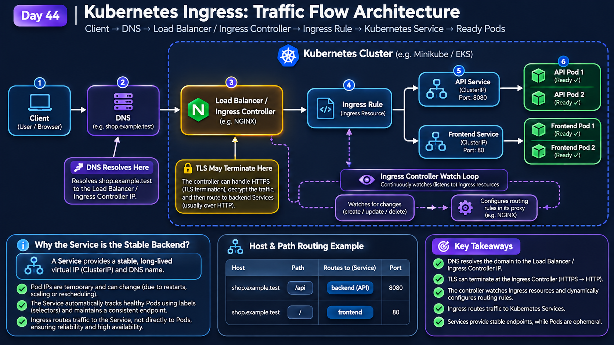

# Day 44 – Kubernetes Production: Ingress & Traffic Management

**DevOps Winter Arc – 90 Days Challenge | Week 7: Kubernetes Production**

Learn • Configure • Route • Secure • Verify

---

## 🎯 Objective

Understand how Kubernetes Ingress manages external HTTP and HTTPS traffic and how an Ingress Controller routes requests to Kubernetes Services.

In this task, I configured an NGINX Ingress Controller on a local Minikube cluster, deployed frontend and backend applications, configured host-based and path-based routing, and enabled HTTPS using a TLS Secret.

I successfully tested both HTTP and HTTPS traffic for the frontend and backend API.

## 🧠 Key Concepts

| Concept | Explanation |
|---|---|
| Ingress | Kubernetes resource that defines HTTP and HTTPS routing rules. |
| Ingress Controller | Component that watches Ingress resources and implements the routing rules. |
| IngressClass | Identifies which Ingress Controller should handle an Ingress resource. |
| Host-based routing | Routes requests according to the requested hostname. |
| Path-based routing | Routes requests according to the URL path. |
| TLS termination | Decrypts HTTPS traffic at the Ingress Controller. |
| Service | Provides a stable endpoint for accessing application Pods. |
| Endpoints | Represent the backend Pod addresses selected by a Service. |

**Important:** Creating an Ingress resource alone does not make routing work. A compatible Ingress Controller must be installed and running.

---

## 🅰️ Task A – Understand Kubernetes Ingress Traffic Flow

The traffic flow explains how a client request reaches an application through Kubernetes Ingress.

### Traffic Flow Diagram



### Traffic Flow Explanation

1. **Client:** A user sends an HTTP or HTTPS request using a browser or client.
2. **DNS Resolution:** The hostname resolves to the address of the Ingress entry point.
3. **Load Balancer / Ingress Controller:** Incoming traffic reaches the Ingress Controller.
4. **Ingress Rules:** The controller evaluates the hostname and URL path against the configured Ingress rules.
5. **Kubernetes Service:** The matching rule forwards the request to the appropriate Service.
6. **Ready Pods:** The Service directs traffic to healthy, matching application Pods.

### DNS Resolution

DNS maps a hostname such as `shop.example.test` to an address where the Ingress Controller can receive traffic.

For this local lab, I used `curl --resolve` to simulate hostname resolution rather than configuring public DNS.

### TLS Termination

TLS termination happens at the NGINX Ingress Controller. The controller uses a Kubernetes TLS Secret containing the certificate and private key to handle HTTPS connections.

### Why does Ingress route to Services instead of directly to Pods?

Pod IP addresses can change when Pods are recreated or rescheduled. A Kubernetes Service provides a stable endpoint and forwards traffic to the matching Pods.

---

## 🅱️ Task B – Inspect Existing Kubernetes Resources

Before creating the Ingress configuration, I inspected the existing cluster resources.

### Commands Used

```bash
# Check existing Ingress resources
kubectl get ingress -A

# Check available IngressClass resources
kubectl get ingressclass

# Inspect Services across namespaces
kubectl get svc -A

# Inspect Pods across namespaces
kubectl get pods -A

# Inspect recent cluster events
kubectl get events -A --sort-by=.lastTimestamp

# Describe a specific Ingress
kubectl describe ingress INGRESS_NAME -n NAMESPACE

# Inspect a Service
kubectl get svc SERVICE_NAME -n NAMESPACE -o wide

# Inspect Service endpoints
kubectl get endpoints SERVICE_NAME -n NAMESPACE
```

### Initial Findings

- No existing Ingress resources were found.
- The Minikube cluster had an NGINX Ingress Controller after enabling the ingress addon.
- The `nginx` IngressClass was available.
- An existing application from Day 34 was running in the `day34-revision` namespace.
- I kept the existing Day 34 application separate and created a dedicated `day44` namespace for this task.

### Ingress Controller Verification

```bash
kubectl get pods -n ingress-nginx
kubectl get ingressclass
```

The NGINX Ingress Controller Pod reached `Running` and `Ready` status.

The available IngressClass was:

```text
NAME    CONTROLLER
nginx   k8s.io/ingress-nginx
```

---

## 🅲 Task C – Design Host-Based and Path-Based Routing

For this task, I designed a simple shop application with two routes.

### Routing Table

| Hostname | Path | Kubernetes Service | Service Port |
|---|---|---|---|
| shop.example.test | `/` | frontend | 80 |
| shop.example.test | `/api` | backend | 8080 |

Both routes use `pathType: Prefix`.

### Create a Dedicated Namespace

```bash
kubectl create namespace day44
```

### Application Architecture

**Frontend**
- NGINX application.
- Two replicas.
- Container port: `80`.
- Service name: `frontend`.
- Service type: ClusterIP.

**Backend**
- HashiCorp HTTP Echo application.
- Two replicas.
- Container port: `8080`.
- Service name: `backend`.
- Service type: ClusterIP.
- Response: `Hello from Day 44 Backend API`.

### Create Application Manifest

File: `day44-apps.yaml`

This manifest defines the frontend and backend Deployments and their corresponding Services.

```yaml
apiVersion: apps/v1
kind: Deployment
metadata:
  name: frontend
  namespace: day44
spec:
  replicas: 2
  selector:
    matchLabels:
      app: frontend
  template:
    metadata:
      labels:
        app: frontend
    spec:
      containers:
        - name: frontend
          image: nginx:1.27
          ports:
            - containerPort: 80
---
apiVersion: v1
kind: Service
metadata:
  name: frontend
  namespace: day44
spec:
  type: ClusterIP
  selector:
    app: frontend
  ports:
    - port: 80
      targetPort: 80
---
apiVersion: apps/v1
kind: Deployment
metadata:
  name: backend
  namespace: day44
spec:
  replicas: 2
  selector:
    matchLabels:
      app: backend
  template:
    metadata:
      labels:
        app: backend
    spec:
      containers:
        - name: backend
          image: hashicorp/http-echo:1.0.0
          args:
            - "-text=Hello from Day 44 Backend API"
            - "-listen=:8080"
          ports:
            - containerPort: 8080
---
apiVersion: v1
kind: Service
metadata:
  name: backend
  namespace: day44
spec:
  type: ClusterIP
  selector:
    app: backend
  ports:
    - port: 8080
      targetPort: 8080
```

### Apply the Application Manifest

```bash
kubectl apply -f day44-apps.yaml
```

### Verify Deployments and Pods

```bash
kubectl get deployments -n day44
kubectl get pods -n day44 -o wide
```

Both Deployments reached `2/2` ready replicas, and all four application Pods were running.

### Verify Services

```bash
kubectl get svc -n day44
```

Observed Services:

```text
NAME       TYPE        CLUSTER-IP       PORT(S)
backend    ClusterIP   10.110.136.28    8080/TCP
frontend   ClusterIP   10.109.123.172   80/TCP
```

### Verify Endpoints

```bash
kubectl get endpoints -n day44
```

Both Services had two backend Pod endpoints:

- Backend: `10.244.0.11:8080`, `10.244.0.12:8080`
- Frontend: `10.244.0.10:80`, `10.244.0.9:80`

This confirmed that the Services selected the expected application Pods.

---

## 🅳 Task D – Create and Configure the Ingress Resource

I created an Ingress resource named `day44-shop` to route requests using the hostname `shop.example.test`.

### Create Ingress Manifest

File: `day44-ingress.yaml`

```yaml
apiVersion: networking.k8s.io/v1
kind: Ingress
metadata:
  name: day44-shop
  namespace: day44
spec:
  ingressClassName: nginx
  rules:
    - host: shop.example.test
      http:
        paths:
          - path: /api
            pathType: Prefix
            backend:
              service:
                name: backend
                port:
                  number: 8080
          - path: /
            pathType: Prefix
            backend:
              service:
                name: frontend
                port:
                  number: 80
```

### Apply Ingress Configuration

```bash
kubectl apply -f day44-ingress.yaml
```

### Verify Ingress

```bash
kubectl get ingress -n day44
kubectl describe ingress day44-shop -n day44
```

### Port Forwarding

I used port forwarding to access the NGINX Ingress Controller locally.

```bash
kubectl port-forward -n ingress-nginx svc/ingress-nginx-controller 8081:80
```

I used port `8081` because the initially selected local port was already occupied.

### Test Frontend HTTP Routing

```bash
curl -i -H "Host: shop.example.test" http://127.0.0.1:8081/
```

**Observed Result:**

```text
HTTP/1.1 200 OK
Content-Type: text/html
```

The NGINX Welcome page was returned successfully.

### Test Backend HTTP Routing

```bash
curl -i -H "Host: shop.example.test" http://127.0.0.1:8081/api
```

**Observed Result:**

```text
HTTP/1.1 200 OK
Content-Type: text/plain; charset=utf-8

Hello from Day 44 Backend API
```

Both frontend and backend HTTP routes worked successfully.

---

## 🅴 Task E – Configure TLS and Enable HTTPS

The next step was to secure the Ingress endpoint using HTTPS.

### Step 1 – Generate a Self-Signed TLS Certificate

I created a `tls` directory and generated a self-signed certificate for `shop.example.test`.

```bash
mkdir -p tls

openssl req -x509 -nodes -days 365 \
  -newkey rsa:2048 \
  -keyout tls/shop.key \
  -out tls/shop.crt \
  -subj "/CN=shop.example.test/O=Day44" \
  -addext "subjectAltName=DNS:shop.example.test"
```

Generated files:

```text
tls/
├── shop.crt
└── shop.key
```

- `shop.crt`: TLS certificate.
- `shop.key`: Private key.

### Step 2 – Create Kubernetes TLS Secret

```bash
kubectl create secret tls shop-tls \
  --cert=tls/shop.crt \
  --key=tls/shop.key \
  -n day44
```

### Step 3 – Verify TLS Secret

```bash
kubectl get secret shop-tls -n day44
kubectl describe secret shop-tls -n day44
```

**Observed Result:**

```text
NAME       TYPE                DATA
shop-tls   kubernetes.io/tls   2
```

Secret data:

```text
tls.crt:  1216 bytes
tls.key:  1704 bytes
```

The Secret was successfully created with the required certificate and private key entries.

### Step 4 – Update Ingress Manifest for HTTPS

I updated `day44-ingress.yaml` by adding the TLS configuration under `spec`.

```yaml
spec:
  ingressClassName: nginx

  tls:
    - hosts:
        - shop.example.test
      secretName: shop-tls

  rules:
    - host: shop.example.test
      http:
        paths:
          - path: /api
            pathType: Prefix
            backend:
              service:
                name: backend
                port:
                  number: 8080
          - path: /
            pathType: Prefix
            backend:
              service:
                name: frontend
                port:
                  number: 80
```

The TLS Secret and Ingress resource are in the same namespace: `day44`.

### Step 5 – Apply Updated Ingress

```bash
kubectl apply -f day44-ingress.yaml
```

### Step 6 – Port Forward HTTPS Traffic

```bash
kubectl port-forward -n ingress-nginx svc/ingress-nginx-controller 8443:443
```

The HTTPS port was forwarded to local port `8443`.

### Step 7 – Test Frontend HTTPS Routing

```bash
curl -k -i --resolve shop.example.test:8443:127.0.0.1 \
  https://shop.example.test:8443/
```

**Observed Result:**

```text
HTTP/2 200
content-type: text/html
```

The NGINX Welcome page was returned successfully over HTTPS.

### Step 8 – Test Backend HTTPS Routing

```bash
curl -k -i --resolve shop.example.test:8443:127.0.0.1 \
  https://shop.example.test:8443/api
```

**Observed Result:**

```text
HTTP/2 200
content-type: text/plain; charset=utf-8
x-app-name: http-echo
x-app-version: 1.0.0

Hello from Day 44 Backend API
```

Both frontend and backend HTTPS routes were successfully verified.

**Note:** `-k` allows curl to accept the self-signed certificate for this local test. `--resolve` maps the hostname to `127.0.0.1` for the request and preserves the hostname for TLS. Public DNS was not configured.

---

## 🛠️ Troubleshooting and Lessons Learned

| Issue / Situation | Explanation / Resolution |
|---|---|
| No Ingress resources found initially | No Ingress had been created yet. I enabled the Minikube ingress addon and created the Day 44 Ingress resource. |
| Ingress Controller not ready immediately | During addon startup, some temporary readiness and mount warnings appeared. I waited and verified that the controller Pod reached `Running` and `Ready`. |
| Local port already in use | Port `8080` was occupied, so I used port `8081` for HTTP port forwarding. |
| No Service endpoints | Check whether the Service selector matches Pod labels and whether Pods are Ready. |
| Ingress returns 404 | Verify the hostname, path, path type and IngressClass. |
| Ingress returns 502 or 503 | Inspect the backend Service, Service port, Pod status and endpoints. |
| TLS certificate warning | A self-signed certificate is not trusted by default. Check the TLS Secret, hostname and certificate configuration. |
| DNS resolution failure | Verify the hostname mapping. For this local lab, `curl --resolve` was used instead of public DNS. |

### Useful Troubleshooting Commands

```bash
# Inspect Ingress
kubectl get ingress -n day44
kubectl describe ingress day44-shop -n day44

# Inspect Ingress Controller
kubectl get pods -n ingress-nginx

# Inspect application Pods
kubectl get pods -n day44 -o wide

# Inspect Services and endpoints
kubectl get svc -n day44
kubectl get endpoints -n day44

# Inspect recent events
kubectl get events -n day44 --sort-by=.lastTimestamp

# Inspect controller logs
kubectl logs -n ingress-nginx deployment/ingress-nginx-controller
```

---

## 📚 Important Interview Questions

**1. What is Kubernetes Ingress?**

Ingress is a Kubernetes API resource that defines rules for routing external HTTP and HTTPS traffic to Services inside a cluster.

**2. What is an Ingress Controller?**

An Ingress Controller watches Ingress resources and implements their routing rules. NGINX Ingress Controller is one example.

**3. What is the difference between Ingress and Ingress Controller?**

Ingress defines the routing rules, while the Ingress Controller processes those rules and handles traffic.

**4. What is IngressClass?**

IngressClass identifies the controller responsible for handling an Ingress resource.

**5. What is host-based routing?**

Host-based routing directs traffic according to the requested hostname, such as `shop.example.test`.

**6. What is path-based routing?**

Path-based routing directs traffic according to the URL path. For example, `/` can route to the frontend and `/api` to the backend.

**7. Why does Ingress route traffic to Services instead of directly to Pods?**

Services provide stable endpoints and select matching Pods even when Pod IP addresses change.

**8. What is TLS termination?**

TLS termination is the process of decrypting HTTPS traffic at the Ingress Controller using a configured TLS certificate and private key.

**9. What is a Kubernetes TLS Secret?**

It is a Kubernetes Secret of type `kubernetes.io/tls` that stores the certificate as `tls.crt` and the private key as `tls.key`.

**10. What happens if an Ingress Controller is not installed?**

The Ingress resource may exist, but no compatible controller will implement its routing rules.

**11. What is the difference between HTTP and HTTPS?**

HTTP sends application traffic without TLS encryption. HTTPS uses TLS to encrypt traffic between the client and the HTTPS endpoint.

**12. What is the purpose of `pathType: Prefix`?**

It matches a URL path based on its prefix, allowing a rule such as `/api` to match paths beginning with `/api`.

---

## 📂 Project Structure

```text
day44-Ingress-Traffic-Management/
│
├── day44-apps.yaml
├── day44-ingress.yaml
├── IngressTrafficFlowDiagram.png
├── .gitignore
│
└── tls/
    ├── shop.crt
    └── shop.key
```

The `tls/` directory is ignored by Git through `.gitignore`.

---

## 🏁 Day 44 – Key Takeaways

Today I learned how Kubernetes Ingress manages external application traffic using host-based and path-based routing.

I configured an NGINX Ingress Controller on Minikube, deployed frontend and backend applications with two replicas each, connected them through ClusterIP Services, and configured an Ingress resource.

I also generated a self-signed TLS certificate, created a Kubernetes TLS Secret, enabled HTTPS and successfully tested both application routes.

**Final Result:**

- Frontend HTTP routing: `200 OK`
- Backend HTTP routing: `200 OK`
- Frontend HTTPS routing: `HTTP/2 200`
- Backend HTTPS routing: `HTTP/2 200`

**Day 44/90 – Kubernetes Production: Ingress & Traffic Management**

Learn → Configure → Route → Secure → Verify
