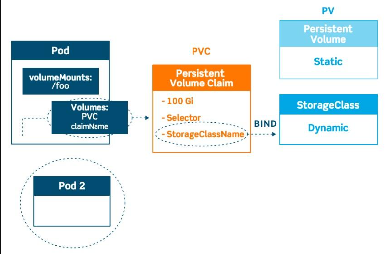

# Day 47 - Kubernetes Production: Persistent Storage

**Day:** 47 / 90  
**Platform:** Kubernetes  
**Environment:** WSL2 Ubuntu + Minikube  
**Cluster:** Minikube  
**Kubernetes Version:** v1.37.0  
**Namespace:** `day47-lab`  
**Focus:** PersistentVolumes (PV), PersistentVolumeClaims (PVC), StorageClasses, Pod Storage and Data Persistence

---

# 1. Today's Mission

Understand how Kubernetes manages persistent storage and how applications can retain data even when their Pods are deleted or recreated.

In Kubernetes, containers have their own filesystem. However, data stored only inside a container can disappear when the container or Pod is replaced.

To solve this problem, Kubernetes provides persistent storage using:

- PersistentVolumes (PV)
- PersistentVolumeClaims (PVC)
- StorageClasses
- Container Storage Interface (CSI)

Today's practical lab demonstrates how to dynamically provision storage, attach it to a Pod, write data into it, delete the Pod, recreate it and verify that the original data is still available.

### Learning Objectives

- Understand why container filesystems are unsuitable for important long-term data.
- Understand the difference between PV, PVC and StorageClass.
- Understand how PV, PVC and Pod work together.
- Create a PersistentVolumeClaim.
- Dynamically provision storage using a StorageClass.
- Mount persistent storage inside a Pod.
- Verify that data survives Pod deletion and recreation.
- Understand reclaim policies and storage cleanup.
- Troubleshoot common Kubernetes storage problems.

---

# 2. Key Concepts

## 2.1 Volume

A Volume is storage made available to a container inside a Pod.

Containers have their own writable filesystem, but that filesystem is not a reliable place for important long-term application data.

When a container is replaced, its writable layer may be lost.

Kubernetes Volumes allow containers to access storage separately from their container filesystem.

Example:

```yaml
volumeMounts:
  - name: app-storage
    mountPath: /data
```

Here, the volume is mounted inside the container at `/data`.

## 2.2 PersistentVolume (PV)

A PersistentVolume is a storage resource available to a Kubernetes cluster.

It represents actual storage that can be used by applications.

A PV can be:

- Created manually by an administrator (static provisioning).
- Created automatically through a StorageClass (dynamic provisioning).

Important PV properties:

- Capacity
- Access modes
- Reclaim policy
- StorageClass
- Volume source

Example:

```bash
kubectl get pv
```

A PV is not directly the application's storage request. It is the storage resource that Kubernetes makes available.

## 2.3 PersistentVolumeClaim (PVC)

A PersistentVolumeClaim is a request for storage made by a Kubernetes workload or user.

Instead of directly managing the storage resource, a developer creates a PVC specifying requirements such as:

- Requested storage capacity
- Access mode
- StorageClass, if required

Kubernetes then finds a suitable PV or dynamically provisions one through a StorageClass.

Example:

```yaml
apiVersion: v1
kind: PersistentVolumeClaim
metadata:
  name: demo-pvc
spec:
  accessModes:
    - ReadWriteOnce
  resources:
    requests:
      storage: 1Gi
```

The PVC requests 1 GiB of storage.

Check PVC status:

```bash
kubectl get pvc
```

A successful claim should show:

```text
STATUS: Bound
```

## 2.4 StorageClass

A StorageClass defines how Kubernetes dynamically provisions storage.

It tells Kubernetes which provisioner should create storage when a PVC requests it.

For example, a cloud-based Kubernetes cluster may use storage provisioners for AWS EBS or other storage systems.

Our Minikube environment uses:

```text
NAME                 PROVISIONER                RECLAIMPOLICY
standard (default)   k8s.io/minikube-hostpath   Delete
```

This means:

- StorageClass name: `standard`
- Provisioner: `k8s.io/minikube-hostpath`
- Default StorageClass: Yes
- Reclaim policy: `Delete`

Because `standard` is the default StorageClass, our PVC does not need to specify `storageClassName`.

Check StorageClasses:

```bash
kubectl get storageclass
```

Or:

```bash
kubectl get sc
```

## 2.5 CSI Driver

CSI stands for Container Storage Interface.

It is a standard interface that allows Kubernetes to communicate with storage systems through storage drivers.

A CSI driver helps Kubernetes perform storage operations such as:

- Creating volumes
- Attaching volumes
- Mounting volumes
- Unmounting volumes
- Deleting volumes

For example, a CSI driver can connect Kubernetes to a cloud storage platform.

## 2.6 Reclaim Policy

A reclaim policy determines what happens to the underlying storage when a PVC is deleted and the PV is released.

Common reclaim policies:

| Policy | Meaning |
|---|---|
| Retain | Keep the underlying storage after the claim is released; manual recovery or cleanup may be required. |
| Delete | Delete the dynamically provisioned backing storage when the claim is released. |

Our Minikube StorageClass uses:

```text
RECLAIMPOLICY: Delete
```

This is important because deleting the PVC can result in deletion of its dynamically provisioned storage.

Always inspect the reclaim policy before deleting a PVC.

---

# 3. Understand How PV, PVC, StorageClass and Pod Work Together

This is one of the most important concepts in Kubernetes persistent storage.

**Refer to the diagram saved in this folder:**



## 3.1 Storage relationship

The four main components have different responsibilities:

| Component | Responsibility |
|---|---|
| StorageClass | Defines how storage should be dynamically provisioned. |
| PVC | Requests storage with specific requirements. |
| PV | Represents the actual provisioned storage resource. |
| Pod | Uses the PVC to mount storage inside its container. |

## 3.2 How the complete process works

**Step 1 — Pod references a PVC**

The Pod specification references a PVC by its name.

```yaml
persistentVolumeClaim:
  claimName: demo-pvc
```

The Pod does not directly request a PV by its name.

**Step 2 — PVC requests storage**

The PVC requests a particular capacity and access mode.

```yaml
resources:
  requests:
    storage: 1Gi
```

**Step 3 — StorageClass provisions storage**

If no suitable existing PV is available, Kubernetes uses the StorageClass provisioner to dynamically create a PV.

In our environment:

```text
standard
    |
    v
k8s.io/minikube-hostpath
```

**Step 4 — PV is created**

The provisioner creates a PersistentVolume with the requested storage characteristics.

**Step 5 — PVC becomes Bound**

Kubernetes binds the PVC to the newly provisioned PV.

```text
PVC: demo-pvc
STATUS: Bound
```

**Step 6 — Pod mounts the PVC**

The Pod uses the PVC and mounts its storage into the container.

```text
Container mount path: /data
PVC: demo-pvc
```

**Step 7 — Application writes data**

The application writes files into `/data`.

The files are stored on the persistent volume rather than only in the container's writable filesystem.

**Step 8 — Pod recreation**

When the Pod is deleted and recreated, the new Pod can mount the same PVC.

The data remains available as long as the underlying persistent storage and claim are retained.

### Architecture to Remember

```text
                STORAGECLASS
                     |
                     | Dynamic provisioning
                     v
              PERSISTENT VOLUME
                     ^
                     |
                Binds to PVC
                     |
                     v
          PERSISTENT VOLUME CLAIM
                     ^
                     |
              Pod references PVC
                     |
                     v
                    POD
                     |
                     v
              CONTAINER
                     |
                     v
               /data mount
                     |
                     v
             Persistent Data
```

**Important:** The Pod uses a PVC, not a StorageClass or PV directly in its volume specification. The PVC is the connection between the workload and the storage resource.

---

# 4. Storage Types

Kubernetes supports different types of storage depending on the use case.

## 4.1 emptyDir

An `emptyDir` volume is temporary storage associated with a Pod.

- It is created when the Pod is assigned to a node.
- Containers inside the Pod can share it.
- It is removed when the Pod is removed from the node.

Example:

```yaml
volumes:
  - name: temporary-storage
    emptyDir: {}
```

Use case: Temporary files, cache data and intermediate processing.

## 4.2 Block Storage — EBS

Amazon Elastic Block Store (EBS) provides block-level storage.

It can be attached to EC2 instances and used by Kubernetes workloads through an appropriate storage driver.

Important considerations:

- Access mode restrictions.
- Volume attachment constraints.
- Availability Zone compatibility.
- Storage capacity and cost.

## 4.3 Shared File Storage — EFS

Amazon Elastic File System (EFS) provides shared file storage.

It can allow multiple workloads to access shared files, depending on the storage configuration and access modes.

Important considerations:

- Shared access requirements.
- Performance configuration.
- Network connectivity.
- Cost.

**Today's lab uses Minikube host-path storage, not AWS EBS or EFS.**

---

# 5. Practical Lab — Kubernetes Persistent Storage

## Step 1 — Inspect the Kubernetes environment

First, verify the current Kubernetes context and namespace.

```bash
kubectl config current-context

kubectl config view --minify | grep namespace

kubectl get nodes
```

Check available StorageClasses:

```bash
kubectl get storageclass
```

Expected StorageClass:

```text
NAME                 PROVISIONER
standard (default)   k8s.io/minikube-hostpath
```

Check the node:

```text
NAME       STATUS
minikube   Ready
```

**Explanation:**

Before creating a PVC, check that a usable StorageClass and provisioner exist.

If there is no usable StorageClass or provisioner, stop and investigate rather than assuming that the PVC will bind.

Do not install an additional storage provisioner without instructor approval.

## Step 2 — Create the namespace

Create a dedicated namespace for Day 47.

```bash
kubectl create namespace day47-lab
```

Switch the current Kubernetes context to the new namespace:

```bash
kubectl config set-context --current --namespace=day47-lab
```

Verify:

```bash
kubectl config view --minify | grep namespace
```

Expected:

```text
namespace: day47-lab
```

## Step 3 — Create the storage manifest

Create a file named:

```text
storage-lab.yaml
```

Command:

```bash
nano storage-lab.yaml
```

Paste the following YAML:

```yaml
apiVersion: v1
kind: PersistentVolumeClaim
metadata:
  name: demo-pvc
spec:
  accessModes:
    - ReadWriteOnce
  resources:
    requests:
      storage: 1Gi
---
apiVersion: v1
kind: Pod
metadata:
  name: storage-demo
spec:
  containers:
    - name: app
      image: busybox:1.36
      command: ["sh", "-c", "while true; do sleep 3600; done"]
      volumeMounts:
        - name: app-storage
          mountPath: /data
  volumes:
    - name: app-storage
      persistentVolumeClaim:
        claimName: demo-pvc
```

Save and exit Nano:

- Press `Ctrl + O`.
- Press Enter.
- Press `Ctrl + X`.

### Explanation of the YAML

**PersistentVolumeClaim section**

```yaml
kind: PersistentVolumeClaim
metadata:
  name: demo-pvc
```

Creates a PVC named `demo-pvc`.

```yaml
accessModes:
  - ReadWriteOnce
```

Requests ReadWriteOnce access.

```yaml
resources:
  requests:
    storage: 1Gi
```

Requests 1 GiB of storage.

**Pod section**

```yaml
kind: Pod
metadata:
  name: storage-demo
```

Creates a Pod named `storage-demo`.

```yaml
image: busybox:1.36
```

Uses BusyBox, a lightweight Linux utility image.

```yaml
command: ["sh", "-c", "while true; do sleep 3600; done"]
```

Keeps the container running so we can execute commands inside it.

**Volume mount section**

```yaml
volumeMounts:
  - name: app-storage
    mountPath: /data
```

Mounts the volume inside the container at `/data`.

**Volume reference section**

```yaml
volumes:
  - name: app-storage
    persistentVolumeClaim:
      claimName: demo-pvc
```

Connects the Pod to the PVC named `demo-pvc`.

The PVC and Pod are created in the same namespace.

## Step 4 — Apply the manifest

Apply the YAML:

```bash
kubectl apply -f storage-lab.yaml
```

Expected:

```text
persistentvolumeclaim/demo-pvc created
pod/storage-demo created
```

Check the PVC:

```bash
kubectl get pvc
```

Expected status:

```text
NAME       STATUS   VOLUME                                     CAPACITY   ACCESS MODES   STORAGECLASS
demo-pvc   Bound    pvc-...                                    1Gi        RWO            standard
```

Check the PV:

```bash
kubectl get pv
```

Expected status:

```text
STATUS: Bound
```

Check the Pod:

```bash
kubectl get pods -o wide
```

Expected:

```text
NAME           READY   STATUS
storage-demo   1/1     Running
```

**Important:** Wait until the PVC is `Bound` and the Pod is `Running` before continuing.

## Step 5 — Inspect the PVC

Run:

```bash
kubectl describe pvc demo-pvc
```

Important fields:

```text
Name:          demo-pvc
Namespace:     day47-lab
StorageClass:  standard
Status:        Bound
Capacity:      1Gi
Access Modes:  RWO
Used By:       storage-demo
```

This confirms that the PVC has successfully obtained storage and is being referenced by the Pod.

## Step 6 — Write data into the persistent volume

Now create a file inside the mounted `/data` directory.

```bash
kubectl exec storage-demo -- sh -c 'echo Day47-storage-test > /data/proof.txt'
```

Read the file:

```bash
kubectl exec storage-demo -- cat /data/proof.txt
```

Expected output:

```text
Day47-storage-test
```

This confirms that the container can write to and read from the mounted volume.

## Step 7 — Inspect the Pod volume mount

Run:

```bash
kubectl describe pod storage-demo
```

Look for:

```text
Mounts:
  /data from app-storage (rw)
```

Also inspect:

```text
Volumes:
  app-storage:
    Type:       PersistentVolumeClaim
    ClaimName:  demo-pvc
    ReadOnly:   false
```

This confirms that:

- The Pod uses the PVC `demo-pvc`.
- The volume is mounted at `/data`.
- The mount is read-write.

## Step 8 — Test data persistence after Pod deletion

This is the most important experiment of Day 47.

The objective is to prove that the data remains available even when the Pod is deleted and recreated.

### 8.1 Read the original file

```bash
kubectl exec storage-demo -- cat /data/proof.txt
```

Expected:

```text
Day47-storage-test
```

### 8.2 Delete only the Pod

```bash
kubectl delete pod storage-demo
```

Expected:

```text
pod "storage-demo" deleted
```

**Important:** Do not delete the PVC.

### 8.3 Recreate the Pod

Apply the same manifest again:

```bash
kubectl apply -f storage-lab.yaml
```

Expected:

```text
persistentvolumeclaim/demo-pvc unchanged
pod/storage-demo created
```

The existing PVC remains unchanged, while the deleted Pod is created again.

Wait for the new Pod to become Ready:

```bash
kubectl wait --for=condition=Ready pod/storage-demo --timeout=120s
```

Expected:

```text
pod/storage-demo condition met
```

### 8.4 Verify the original file

```bash
kubectl exec storage-demo -- cat /data/proof.txt
```

Expected:

```text
Day47-storage-test
```

**Result:**

The original file is still available after Pod deletion and recreation.

This demonstrates persistent storage in Kubernetes.

The Pod was temporary, but the PVC and its bound storage remained available.

---

# 6. Inspect PV, PVC and Storage Details

## 6.1 List all PersistentVolumes

```bash
kubectl get pv
```

Inspect a particular PV:

```bash
kubectl describe pv <PV-NAME>
```

Replace `<PV-NAME>` with the actual PV name returned by `kubectl get pv`.

Important fields:

- Capacity
- Access modes
- Reclaim policy
- Status
- Claim
- StorageClass

## 6.2 List PVCs

```bash
kubectl get pvc
```

Inspect the claim:

```bash
kubectl describe pvc demo-pvc
```

## 6.3 List StorageClasses

```bash
kubectl get storageclass
```

## 6.4 List PVCs across namespaces

```bash
kubectl get pvc -A
```

## 6.5 Inspect the Pod

```bash
kubectl describe pod storage-demo
```

## 6.6 Inspect Kubernetes events

```bash
kubectl get events --sort-by=.metadata.creationTimestamp
```

Events help identify provisioning, scheduling, attachment and mounting problems.

---

# 7. Troubleshooting Kubernetes Persistent Storage

Persistent storage can fail at different stages: provisioning, binding, scheduling, attaching or mounting.

The following are common problems and the commands used to investigate them.

## Problem 1 — PVC remains Pending

### Symptoms

```text
NAME       STATUS
demo-pvc   Pending
```

### Possible causes

- No default StorageClass exists.
- StorageClass provisioner is unavailable.
- Requested capacity cannot be provisioned.
- Access mode is unsupported.
- Storage provisioning has failed.

### Troubleshooting commands

Check StorageClasses:

```bash
kubectl get storageclass
```

Check PVC details:

```bash
kubectl describe pvc demo-pvc
```

Check PVs:

```bash
kubectl get pv
```

Check events:

```bash
kubectl get events --sort-by=.metadata.creationTimestamp
```

### What to look for

If the events show:

```text
ExternalProvisioning
```

Kubernetes is waiting for an external provisioner to create the volume.

If the events show provisioning errors, investigate the provisioner and StorageClass.

**Solution:** Verify that the StorageClass exists, its provisioner is working and the requested storage configuration is supported.

Do not install another provisioner automatically. Follow the lab instructions and ask the instructor if no usable provisioner is available.

## Problem 2 — Pod remains Pending

### Symptoms

```text
NAME           READY   STATUS
storage-demo   0/1     Pending
```

### Possible causes

- PVC is not Bound.
- No suitable node is available.
- Insufficient node resources.
- Scheduling constraints prevent placement.

### Troubleshooting commands

```bash
kubectl get pvc
kubectl get pv
kubectl get pods -o wide
kubectl describe pod storage-demo
kubectl get nodes
kubectl get events --sort-by=.metadata.creationTimestamp
```

### Solution

First verify that the PVC is Bound.

Then inspect Pod events to identify the actual scheduling problem.

Do not assume every Pending Pod has a storage problem.

## Problem 3 — FailedMount or FailedAttachVolume

### Symptoms

The Pod may show:

```text
ContainerCreating
```

Or its events may contain:

```text
FailedMount
```

or:

```text
FailedAttachVolume
```

### Possible causes

- PVC is not available.
- Volume attachment failed.
- CSI driver is unavailable.
- Storage backend is unhealthy.
- Volume access constraints prevent attachment.

### Troubleshooting commands

```bash
kubectl describe pod storage-demo
```

```bash
kubectl describe pvc demo-pvc
```

```bash
kubectl get pv
```

```bash
kubectl get events --sort-by=.metadata.creationTimestamp
```

If the cluster uses CSI drivers, inspect the relevant CSI Pods and logs:

```bash
kubectl get pods -A
```

### Solution

Verify the PVC is Bound, inspect the Pod events and check whether the storage driver or backend is healthy.

## Problem 4 — Multi-Attach error

### Symptoms

An event may show:

```text
Multi-Attach error
```

### Explanation

Some block storage volumes cannot be attached read-write to multiple nodes simultaneously.

For example, an EBS volume using an incompatible access mode may still be attached to another node.

### Troubleshooting commands

```bash
kubectl get pods -o wide
```

```bash
kubectl get pv
```

```bash
kubectl describe pod storage-demo
```

```bash
kubectl describe pv <PV-NAME>
```

### Solution

- Check which node is using the volume.
- Check whether another Pod is still using it.
- Verify the storage access mode.
- Follow the storage provider's attachment and recovery procedure.

Do not force-detach a volume without understanding the risk of data corruption.

## Problem 5 — Data disappears after Pod recreation

### Symptoms

The new Pod starts successfully, but the file is missing.

### Possible causes

- The Pod is using a different PVC.
- The volume is mounted at the wrong path.
- The application wrote data outside the mounted directory.
- The PVC was deleted and a new volume was provisioned.

### Troubleshooting commands

Check PVC:

```bash
kubectl get pvc
```

Inspect Pod mounts:

```bash
kubectl describe pod storage-demo
```

Check the file:

```bash
kubectl exec storage-demo -- ls -l /data
```

Read the file:

```bash
kubectl exec storage-demo -- cat /data/proof.txt
```

### Solution

Verify that the new Pod references the same PVC:

```yaml
persistentVolumeClaim:
  claimName: demo-pvc
```

Verify that the container mount path is correct:

```yaml
volumeMounts:
  - name: app-storage
    mountPath: /data
```

Make sure the application writes files inside `/data`, not somewhere else in the container filesystem.

## Problem 6 — Permission denied when writing to the volume

### Symptoms

The container may return:

```text
Permission denied
```

### Possible causes

- Container user does not have permission to write to the mounted directory.
- Volume filesystem ownership is incompatible.
- Security context settings restrict access.

### Troubleshooting commands

Check the container user:

```bash
kubectl exec storage-demo -- id
```

Inspect directory permissions:

```bash
kubectl exec storage-demo -- ls -ld /data
```

Inspect Pod configuration:

```bash
kubectl describe pod storage-demo
```

### Solution

Check the application's user and group IDs and the volume's filesystem permissions.

Use an appropriate Pod security context or storage ownership configuration when needed.

Do not blindly run privileged containers or change permissions recursively without understanding the security impact.

---

# 8. Interview Questions and Answers

## Q1. What is the difference between PV and PVC?

**Answer:**

A PersistentVolume (PV) is the actual storage resource available in the Kubernetes cluster.

A PersistentVolumeClaim (PVC) is a request for storage made by a workload or user.

The PVC requests storage with specific requirements, and Kubernetes binds it to a suitable PV.

Simple explanation:

- PV = Actual storage resource.
- PVC = Request for storage.

## Q2. What is a StorageClass?

**Answer:**

A StorageClass defines how Kubernetes dynamically provisions storage.

It specifies the provisioner responsible for creating storage when a PVC requests it.

For example, our Minikube cluster uses:

```text
standard
```

with the provisioner:

```text
k8s.io/minikube-hostpath
```

## Q3. What does ReadWriteOnce mean?

**Answer:**

ReadWriteOnce (RWO) means a volume can be mounted as read-write by a single node at a time.

It does not necessarily mean only one Pod can use that volume. Multiple Pods on the same node may be able to use it, depending on the storage implementation and configuration.

## Q4. Why can a PVC remain Pending?

**Answer:**

A PVC may remain Pending when Kubernetes cannot find or provision suitable storage.

Common reasons include:

- Missing StorageClass.
- Unavailable storage provisioner.
- Insufficient storage capacity.
- Unsupported access mode.
- Provisioning errors.

Useful commands:

```bash
kubectl get storageclass
kubectl describe pvc demo-pvc
kubectl get pv
kubectl get events --sort-by=.metadata.creationTimestamp
```

## Q5. What does a CSI driver do?

**Answer:**

CSI stands for Container Storage Interface.

It provides a standard interface through which Kubernetes communicates with external storage systems.

It helps Kubernetes create, attach, mount, unmount and delete storage volumes through the appropriate driver.

## Q6. Why should we check the reclaim policy before deleting a PVC?

**Answer:**

The reclaim policy determines what happens to the backing storage after the PVC is released.

For example:

- `Retain`: Storage is kept for manual recovery or cleanup.
- `Delete`: Dynamically provisioned backing storage can be deleted.

Our Minikube StorageClass uses:

```text
RECLAIMPOLICY: Delete
```

Therefore, deleting the PVC can cause the underlying storage to be deleted.

Always inspect the PV reclaim policy before deleting a claim.

---

# 9. Useful Kubernetes Storage Commands

| Command | Purpose |
|---|---|
| `kubectl get storageclass` | List StorageClasses |
| `kubectl get sc` | Short form for StorageClasses |
| `kubectl get pv` | List PersistentVolumes |
| `kubectl get pvc` | List PVCs in the current namespace |
| `kubectl get pvc -A` | List PVCs across all namespaces |
| `kubectl describe pvc demo-pvc` | Inspect PVC details and events |
| `kubectl describe pv <PV-NAME>` | Inspect PV details |
| `kubectl describe pod storage-demo` | Inspect Pod mounts and events |
| `kubectl get events --sort-by=.metadata.creationTimestamp` | Inspect recent events |
| `kubectl exec storage-demo -- ls -l /data` | Inspect files inside the mounted directory |
| `kubectl exec storage-demo -- cat /data/proof.txt` | Read the test file |
| `kubectl delete pod storage-demo` | Delete the Pod without deleting its PVC |
| `kubectl apply -f storage-lab.yaml` | Apply or reapply the manifest |

---

# 10. Cleanup — Remove Day 47 Resources

Cleanup is important because persistent storage can remain allocated after workloads are removed.

Our Day 47 environment uses:

```text
StorageClass: standard
Provisioner: k8s.io/minikube-hostpath
Reclaim Policy: Delete
```

The lab's PVC dynamically provisioned a PV.

After finishing the practical work, remove only the Day 47 namespace.

### Step 1 — Verify the current namespace

```bash
kubectl config view --minify | grep namespace
```

### Step 2 — Delete the Day 47 namespace

```bash
kubectl delete namespace day47-lab
```

Deleting the namespace removes its Pod and PVC.

Because the PV uses the `Delete` reclaim policy, the dynamically provisioned backing storage should also be deleted after the PVC is released and the provisioner completes cleanup.

### Step 3 — Verify PV cleanup

```bash
kubectl get pv
```

Check that the Day 47 PV is no longer present.

If it remains in `Terminating`, `Released` or another unexpected state, inspect it:

```bash
kubectl describe pv <PV-NAME>
```

Do not manually delete shared or unrelated PVs.

### Step 4 — Verify PVC cleanup

```bash
kubectl get pvc -A
```

Confirm that `day47-lab/demo-pvc` is gone.

### Step 5 — Restore the default namespace

```bash
kubectl config set-context --current --namespace=default
```

Verify:

```bash
kubectl config view --minify | grep namespace
```

Expected:

```text
namespace: default
```

**Important cleanup rules:**

- Do not delete other lab namespaces.
- Do not delete the shared `standard` StorageClass.
- Do not disable Metrics Server.
- Do not remove Minikube or shared cluster components.
- Do not delete PVs belonging to other labs.
- Always inspect reclaim policy before deleting PVCs.
- Avoid creating cloud storage resources for this local Minikube lab.

---

# 11. Key Takeaways

1. A container's writable filesystem is not suitable for important long-term data.
2. A PersistentVolume represents storage available to the Kubernetes cluster.
3. A PersistentVolumeClaim requests storage.
4. A StorageClass defines how storage can be dynamically provisioned.
5. A Pod references a PVC to mount persistent storage into a container.
6. The PVC connects the workload to the PV.
7. Deleting a Pod does not automatically delete its PVC.
8. Recreating a Pod with the same PVC allows it to access the existing data.
9. Reclaim policies determine what happens to backing storage after a claim is released.
10. CSI drivers connect Kubernetes to external storage systems.

### Final Architecture to Remember

```text
StorageClass
     |
     | Dynamic provisioning
     v
PersistentVolume (PV)
     |
     | Bound to
     v
PersistentVolumeClaim (PVC)
     |
     | Referenced by
     v
Pod
     |
     | Mounts
     v
Container (/data)
     |
     v
Persistent Application Data
```

**Day 47 Complete — Kubernetes Persistent Storage**

You now understand how Kubernetes uses PVs, PVCs and StorageClasses to provide persistent storage to Pods, and why data can survive Pod deletion and recreation when it is stored on a persistent volume.
