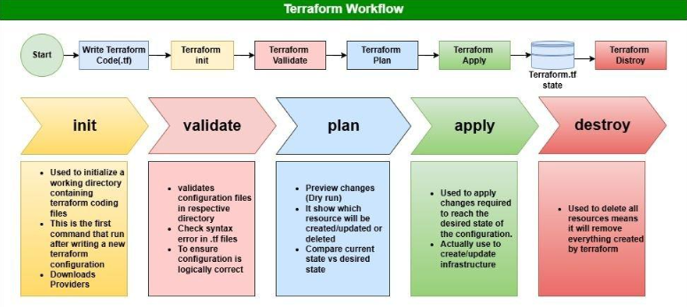

# Day 51 — Terraform: Infrastructure as Code Fundamentals

## Overview

Terraform is an Infrastructure as Code (IaC) tool that allows us to define, provision, and manage infrastructure using configuration files.

In this lab, we learn Terraform fundamentals and its workflow by creating a simple text file on our local machine using the **Local Provider**.

**Important:** This assignment uses a local resource only. It does not create AWS infrastructure or incur AWS charges.

### Learning Objectives

By completing this lab, you will learn how to:

- Understand Infrastructure as Code (IaC).
- Understand Terraform providers, resources, variables, outputs, and state.
- Install Terraform on Ubuntu/WSL2.
- Initialize a Terraform project.
- Format and validate Terraform configuration.
- Generate and review an execution plan.
- Apply approved infrastructure changes.
- Inspect Terraform outputs and state.
- Modify an existing resource.
- Safely destroy resources created during the lab.

---

## 1. What Is Terraform?

**Terraform** is an open-source Infrastructure as Code tool developed by HashiCorp.

Traditionally, infrastructure is created and managed manually through cloud-provider consoles or command-line interfaces. Terraform makes this process repeatable by allowing us to describe the desired infrastructure in configuration files.

These configuration files are written in **HashiCorp Configuration Language (HCL)**.

For example, instead of manually creating a file on our computer, we can describe that file as a Terraform resource and let Terraform create and manage it.

### Why Do We Use Terraform?

1. **Automation:** Automates infrastructure creation and management.
2. **Consistency:** Helps create infrastructure in a repeatable way.
3. **Version control:** Configuration files can be stored in Git.
4. **Change tracking:** Terraform plans show proposed changes before applying them.
5. **Reusability:** Variables allow configurations to be reused with different values.
6. **Multi-platform support:** Providers allow Terraform to work with different platforms and services.

### What Is Infrastructure as Code (IaC)?

Infrastructure as Code means managing infrastructure through configuration files instead of performing every operation manually.

For example:

- Manually creating a virtual machine through a cloud console is a manual process.
- Defining a virtual machine in Terraform configuration and applying it is Infrastructure as Code.

**Main advantage:** Infrastructure becomes easier to automate, reproduce, review, and manage.

---

## 2. Fundamental Terraform Concepts

### 2.1 Provider

A provider is a plugin that allows Terraform to communicate with a particular platform or service.

Examples:

| Provider | Purpose |
|---|---|
| AWS | Manage AWS infrastructure |
| AzureRM | Manage Microsoft Azure resources |
| Google | Manage Google Cloud resources |
| Kubernetes | Manage Kubernetes resources |
| Local | Manage local files and directories |

In this lab, we use the **Local Provider** because we want to create a file on our computer without provisioning cloud infrastructure.

### 2.2 Resource

A resource represents an object that Terraform manages.

Examples include:

- Virtual machines
- Storage buckets
- Networks
- Databases
- Local files

Our lab uses this resource:

```hcl
resource "local_file" "welcome" {
  filename = "${path.module}/hello.txt"
  content  = "Hello from Terraform: ${var.project_name}"
}
```

Here:

- `resource` declares a Terraform-managed object.
- `local_file` is the resource type.
- `welcome` is the resource name inside this configuration.
- `filename` specifies where the file will be created.
- `content` specifies the text written into the file.

### 2.3 Variable

A variable is an input value used to make Terraform configurations reusable and flexible.

Example:

```hcl
variable "project_name" {
  type    = string
  default = "winter-arc-day51"
}
```

Explanation:

- `variable` declares an input variable.
- `project_name` is the variable name.
- `type = string` means it accepts text.
- `default` defines the value used when no other value is provided.

We can change the default value without rewriting the resource configuration.

### 2.4 Output

An output displays useful information after Terraform applies the configuration.

Example:

```hcl
output "created_file_path" {
  value = local_file.welcome.filename
}
```

Explanation:

- `output` declares an output value.
- `created_file_path` is the output name.
- `local_file.welcome.filename` refers to the filename attribute of our resource.

We can display this value using:

```bash
terraform output
```

### 2.5 State

Terraform state is Terraform's record of the infrastructure it manages.

The state file is normally named:

```text
terraform.tfstate
```

Terraform uses state to:

- Track resources it manages.
- Connect configuration resources to real objects.
- Understand what currently exists.
- Calculate changes during a plan.

**Important security note:** State files can contain sensitive information. Never publish or share them publicly. Do not edit state files manually.

### 2.6 Data Source

A data source allows Terraform to read information about an existing object without managing that object as a resource.

For example:

- A resource can create a new infrastructure object.
- A data source can retrieve information about an already-existing object.

The Day 51 practical lab focuses on resources; data sources are included here as an important Terraform concept.

### 2.7 Terraform Configuration Language (HCL)

HCL stands for HashiCorp Configuration Language.

It is the language used to write Terraform configuration files.

Example:

```hcl
provider "local" {}

resource "local_file" "example" {
  filename = "${path.module}/example.txt"
  content  = "Hello Terraform"
}
```

HCL uses blocks, arguments, expressions, and references to describe the desired configuration.

---

## 3. Terraform Workflow



Terraform follows a defined workflow to create and manage infrastructure safely.

### Step 1 — Write Configuration

Create Terraform configuration files, usually with the `.tf` extension.

Example:

```text
main.tf
```

This file describes the provider, variables, resources, and outputs.

### Step 2 — Initialize the Project

```bash
terraform init
```

What it does:

- Initializes the working directory.
- Downloads required provider plugins.
- Prepares Terraform's working environment.
- Creates the `.terraform` directory.
- Creates or updates `.terraform.lock.hcl`.

### Step 3 — Format Configuration

```bash
terraform fmt
```

What it does:

- Formats Terraform files consistently.
- Fixes indentation and spacing.
- Makes configuration easier to read.

### Step 4 — Validate Configuration

```bash
terraform validate
```

What it does:

- Checks Terraform configuration syntax.
- Checks whether the configuration is structurally valid.
- Identifies configuration errors before applying changes.

### Step 5 — Generate an Execution Plan

```bash
terraform plan
```

What it does:

- Compares the configuration with Terraform's current state.
- Determines which changes are required.
- Displays proposed resource additions, modifications, or deletions.

Always review the plan before applying changes.

### Step 6 — Apply Changes

```bash
terraform apply
```

What it does:

- Displays the proposed changes.
- Asks for confirmation.
- Creates or updates resources after approval.
- Updates Terraform state.

Type `yes` only after confirming that the plan contains the expected changes.

### Step 7 — Inspect Outputs and State

```bash
terraform output
terraform state list
```

These commands help us inspect the output values and resources tracked by Terraform.

### Step 8 — Destroy Lab Resources

```bash
terraform plan -destroy
terraform destroy
```

What it does:

- Shows which managed resources would be removed.
- Requests confirmation before destruction.
- Removes resources managed by the configuration.

Always inspect the destroy plan before confirming.

### Important Terraform Commands

| Command | Purpose |
|---|---|
| `terraform version` | Displays installed Terraform version |
| `terraform init` | Initializes the project |
| `terraform fmt` | Formats configuration files |
| `terraform validate` | Validates configuration |
| `terraform plan` | Previews proposed changes |
| `terraform apply` | Applies approved changes |
| `terraform output` | Displays output values |
| `terraform state list` | Lists resources in state |
| `terraform state show` | Displays details of a resource |
| `terraform plan -destroy` | Previews resource destruction |
| `terraform destroy` | Destroys managed resources |

---

## 4. Installation Process — Terraform on Ubuntu/WSL2

This lab uses Ubuntu inside WSL2.

Terraform should be installed from the official HashiCorp package repository. Avoid downloading executables from unknown websites.

### Step 1 — Update Ubuntu Packages

```bash
sudo apt update
```

This refreshes the package information available to Ubuntu.

### Step 2 — Install Required Packages

```bash
sudo apt install -y wget gpg
```

Explanation:

- `wget` downloads files from the internet.
- `gpg` verifies cryptographic signatures and package keys.
- `-y` automatically confirms package installation.

### Step 3 — Add the HashiCorp GPG Key

```bash
wget -O- https://apt.releases.hashicorp.com/gpg | sudo gpg --dearmor -o /usr/share/keyrings/hashicorp-archive-keyring.gpg
```

This downloads the official HashiCorp signing key and stores it in the system keyring directory.

Verify the fingerprint:

```bash
gpg --no-default-keyring \
  --keyring /usr/share/keyrings/hashicorp-archive-keyring.gpg \
  --fingerprint
```

Compare the displayed fingerprint with the one published in HashiCorp's official installation documentation before proceeding.

### Step 4 — Add the HashiCorp Repository

```bash
echo "deb [arch=$(dpkg --print-architecture) signed-by=/usr/share/keyrings/hashicorp-archive-keyring.gpg] https://apt.releases.hashicorp.com $(grep -oP '(?<=UBUNTU_CODENAME=).*' /etc/os-release || lsb_release -cs) main" | sudo tee /etc/apt/sources.list.d/hashicorp.list
```

This adds the official HashiCorp APT repository to Ubuntu.

### Step 5 — Update Package Information

```bash
sudo apt update
```

Ubuntu now refreshes its package information, including the newly added HashiCorp repository.

### Step 6 — Install Terraform

```bash
sudo apt install -y terraform
```

This installs Terraform using the official package repository.

### Step 7 — Verify Installation

```bash
terraform version
```

Expected output format:

```text
Terraform v1.x.x
on linux_amd64
```

The exact version number may differ depending on the available package release.

**Installation reference:** [Official HashiCorp Terraform installation guide](https://developer.hashicorp.com/terraform/install)

---

## 5. Lab A — Verify Terraform Installation

### Objective

Verify that Terraform is installed and accessible from the terminal.

### Command

```bash
terraform version
```

### Explanation

This command displays the installed Terraform version and platform information.

If Terraform is installed correctly, the command should display its version.

If the terminal reports `terraform: command not found`, verify the installation and PATH before proceeding.

---

## 6. Lab B — Create a Local Terraform Project

### Objective

Create a local text file using Terraform's Local Provider.

This lab does not create AWS resources.

### Step 1 — Create the Project Directory

```bash
mkdir -p ~/DevOps-Winter-Arc/day51-terraform
```

This creates the Day 51 project directory.

Navigate into it:

```bash
cd ~/DevOps-Winter-Arc/day51-terraform
```

Check the current directory:

```bash
pwd
```

### Step 2 — Create the Terraform Configuration File

```bash
nano main.tf
```

Paste the following configuration:

```hcl
terraform {
  required_providers {
    local = {
      source  = "hashicorp/local"
      version = "~> 2.5"
    }
  }
}

provider "local" {}

variable "project_name" {
  type    = string
  default = "winter-arc-day51"
}

resource "local_file" "welcome" {
  filename = "${path.module}/hello.txt"
  content  = "Hello from Terraform: ${var.project_name}"
}

output "created_file_path" {
  value = local_file.welcome.filename
}
```

Save the file:

- Press `Ctrl + O`.
- Press `Enter`.
- Press `Ctrl + X`.

### Step 3 — Understand the Configuration

#### Terraform Block

```hcl
terraform {
  required_providers {
    local = {
      source  = "hashicorp/local"
      version = "~> 2.5"
    }
  }
}
```

This block tells Terraform which provider is required.

- `required_providers` declares provider dependencies.
- `local` is the provider's local configuration name.
- `source` identifies the provider's official registry address.
- `version` specifies the allowed provider version range.

The `~> 2.5` constraint allows compatible 2.x releases starting from 2.5, while excluding 3.x releases.

#### Provider Block

```hcl
provider "local" {}
```

This configures the Local Provider.

No additional settings are required for this simple lab.

#### Variable Block

```hcl
variable "project_name" {
  type    = string
  default = "winter-arc-day51"
}
```

This creates an input variable named `project_name`.

The resource uses this variable to generate the file's content.

#### Resource Block

```hcl
resource "local_file" "welcome" {
  filename = "${path.module}/hello.txt"
  content  = "Hello from Terraform: ${var.project_name}"
}
```

This declares a local file that Terraform should manage.

- `local_file` is the resource type.
- `welcome` is the resource name.
- `path.module` represents the directory containing the current module.
- `filename` specifies the destination file.
- `var.project_name` references the declared variable.

The generated file will be named `hello.txt`.

#### Output Block

```hcl
output "created_file_path" {
  value = local_file.welcome.filename
}
```

This displays the path of the generated file after Terraform applies the configuration.

### Step 4 — Initialize Terraform

```bash
terraform init
```

Terraform downloads the Local Provider and initializes the working directory.

Expected result: Terraform reports successful initialization.

### Step 5 — Format the Configuration

```bash
terraform fmt
```

Terraform formats the `.tf` configuration file.

### Step 6 — Validate the Configuration

```bash
terraform validate
```

Expected result:

```text
Success! The configuration is valid.
```

### Step 7 — Review the Execution Plan

```bash
terraform plan
```

Expected result: Terraform should propose creating exactly one resource:

```text
local_file.welcome
```

The plan should show:

```text
Plan: 1 to add, 0 to change, 0 to destroy.
```

The exact output may contain additional details.

**Safety check:** Do not apply if the plan proposes unexpected resources or changes.

### Step 8 — Apply the Configuration

```bash
terraform apply
```

Terraform displays the execution plan and asks for confirmation.

Type:

```text
yes
```

Only if the plan shows the expected creation of the single local file resource.

Terraform now creates `hello.txt` and records the resource in its state.

### Step 9 — Verify Terraform Output

```bash
terraform output
```

Expected output will contain the generated file path, similar to:

```text
created_file_path = "/home/<user>/DevOps-Winter-Arc/day51-terraform/hello.txt"
```

The actual path depends on your system.

### Step 10 — Verify the Generated File

```bash
cat hello.txt
```

Expected content:

```text
Hello from Terraform: winter-arc-day51
```

**Lab B completed:** Terraform successfully created a local file using the Local Provider.

---

## 7. Lab C — Change and Inspect the Configuration

### Objective

Modify the variable value and observe how Terraform detects a change to an existing resource.

### Step 1 — Open the Configuration

```bash
nano main.tf
```

Find:

```hcl
default = "winter-arc-day51"
```

Change it to:

```hcl
default = "terraform-day51-updated"
```

Save the file.

### Step 2 — Format the Configuration

```bash
terraform fmt
```

### Step 3 — Validate the Configuration

```bash
terraform validate
```

Expected result:

```text
Success! The configuration is valid.
```

### Step 4 — Generate a New Plan

```bash
terraform plan
```

Terraform compares the updated configuration with the existing state.

It should detect that the file content needs to change.

For the Local Provider, the file may be replaced because the content attribute requires a new file value.

Review the proposed action carefully before proceeding.

### Why Does Terraform Propose an Update?

Initially, the file contains:

```text
Hello from Terraform: winter-arc-day51
```

After changing the variable, the desired content becomes:

```text
Hello from Terraform: terraform-day51-updated
```

Terraform detects the difference between the desired configuration and the previously managed resource.

It therefore proposes the necessary change.

### Step 5 — Apply the Change

```bash
terraform apply
```

Review the plan again and type `yes` only if the proposed change is expected.

### Step 6 — Verify the Updated File

```bash
cat hello.txt
```

Expected content:

```text
Hello from Terraform: terraform-day51-updated
```

**Lab C completed:** You changed a Terraform variable and observed how Terraform detects and applies configuration changes.

---

## 8. Lab D — Inspect Terraform State

### Objective

Understand how Terraform tracks managed resources through its state.

### Step 1 — List Managed Resources

```bash
terraform state list
```

Expected output:

```text
local_file.welcome
```

This is the resource address tracked by Terraform.

### Step 2 — Inspect the Resource

```bash
terraform state show local_file.welcome
```

This displays the attributes Terraform currently records for the resource.

Look for attributes such as:

- `filename`
- `content`
- `id`

Record the resource address and at least two attributes shown in your actual output.

### What Is the Resource Address?

```text
local_file.welcome
```

It consists of:

- `local_file`: resource type.
- `welcome`: resource name.

Terraform uses this address to identify the resource in the configuration and state.

### Why Should We Protect terraform.tfstate?

The state file stores information about Terraform-managed resources and may contain sensitive values.

Publishing it in a public Git repository can expose information that should remain private.

Therefore:

- Do not commit state files to public repositories.
- Do not share state files casually.
- Do not edit state files manually.
- Use appropriate access controls and secure storage when working with shared infrastructure.

**Lab D completed:** You inspected Terraform state and identified the managed resource.

---

## 9. Important Terraform Project Files

A Terraform project contains configuration files, provider data, state information, and supporting files.

| File or Directory | Purpose |
|---|---|
| `main.tf` | Main Terraform configuration containing providers, variables, resources, and outputs |
| `.terraform/` | Local working directory containing downloaded provider and module data |
| `.terraform.lock.hcl` | Records selected provider versions and checksums |
| `terraform.tfstate` | Records Terraform's managed resource state |
| `terraform.tfstate.backup` | Backup state file that may be created during state changes |
| `.gitignore` | Defines files and directories Git should ignore |
| `hello.txt` | Text file generated by this Day 51 lab |

### 9.1 main.tf

This is the primary configuration file in our lab.

It contains:

- Terraform provider requirements.
- Provider configuration.
- Input variable.
- Local file resource.
- Output value.

### 9.2 .terraform/

This directory contains Terraform's local working data, including downloaded provider plugins.

It is generated during initialization.

Normally, it should not be committed to Git.

### 9.3 .terraform.lock.hcl

This file records the selected provider versions and checksums.

It helps ensure consistent provider selection across different machines.

**Best practice:** Commit `.terraform.lock.hcl` to version control.

### 9.4 terraform.tfstate

This file records Terraform's view of managed infrastructure.

It is important for Terraform to understand existing resources and calculate future changes.

**Security:** Protect this file. Do not publish it or manually edit it.

### 9.5 .gitignore

This file tells Git which files and directories should not be tracked.

Create it:

```bash
nano .gitignore
```

Add:

```gitignore
.terraform/
*.tfstate
*.tfstate.*
*.tfstate.backup
crash.log
*.tfvars
!example.tfvars
```

Save the file.

Explanation:

- `.terraform/` ignores the local Terraform working directory.
- `*.tfstate` ignores Terraform state files.
- `*.tfstate.*` ignores state-related files.
- `*.tfstate.backup` ignores state backup files.
- `crash.log` ignores Terraform crash logs.
- `*.tfvars` ignores variable-value files that may contain sensitive values.
- `!example.tfvars` allows an example variable file to be tracked.

Never commit credentials or secret values. Review ignore rules for your project's requirements.

---

## 10. Troubleshooting Guide

### Problem 1 — Terraform Command Not Found

**Error:**

```text
terraform: command not found
```

**Possible cause:**

Terraform is not installed or its executable is not available through PATH.

**Solution:**

Check:

```bash
terraform version
```

If the command is still unavailable, verify the installation and follow the official HashiCorp Ubuntu installation procedure.

### Problem 2 — Provider Download Failed

**Possible error:**

```text
Error: Failed to install provider
```

**Possible causes:**

- Internet connectivity problems.
- Incorrect provider source.
- Invalid version constraint.
- Registry access problems.

**Solution:**

Check your internet connection and verify the provider declaration in `main.tf`.

For this lab, it should contain:

```hcl
source  = "hashicorp/local"
version = "~> 2.5"
```

Then retry:

```bash
terraform init
```

### Problem 3 — Terraform Validation Error

**Possible error:**

```text
Error: Invalid block definition
```

**Possible causes:**

- Missing closing braces.
- Incorrect quotation marks.
- Typographical mistakes.
- Incorrect argument types.
- Invalid HCL syntax.

**Solution:**

Run:

```bash
terraform fmt
terraform validate
```

Inspect the file and the line number mentioned in the error.

### Problem 4 — Unexpected Terraform Plan

**Problem:**

Terraform proposes changes that you did not expect.

**Solution:**

Do not apply the changes immediately.

Run:

```bash
terraform plan
```

Carefully inspect the proposed resource actions and compare them with your configuration.

Only apply when you understand and approve the changes.

### Problem 5 — Terraform State Lock or State Mismatch

**Possible causes:**

- Another Terraform operation is running.
- An earlier operation did not finish successfully.
- State information is inconsistent.
- A remote backend has a locking problem.

**Solution:**

Investigate the active operation and backend before making changes.

Do not delete state files as a quick fix. Do not manually edit the state file.

---

## 11. Day 51 Cleanup — Destroy the Local Resource

### Objective

Safely remove the resource created during this lab.

Make sure you are inside the project directory:

```bash
cd ~/DevOps-Winter-Arc/day51-terraform
```

### Step 1 — Review the Destroy Plan

```bash
terraform plan -destroy
```

This previews the resources Terraform intends to remove.

For this assignment, the plan should refer only to:

```text
local_file.welcome
```

### Step 2 — Destroy the Resource

```bash
terraform destroy
```

Review the plan and type:

```text
yes
```

Only if it refers exclusively to the local file resource created in this lab.

Terraform removes the generated `hello.txt` file and updates its state.

### Step 3 — Verify Cleanup

```bash
ls
```

The generated `hello.txt` file should no longer be present.

You can also inspect state:

```bash
terraform state list
```

There should be no remaining managed resources from this lab.

**Cost and safety note:** This assignment does not create AWS resources. Never apply AWS infrastructure without checking the account, region, execution plan, and expected costs.

---

## 12. Important Interview Questions and Answers

### Q1. What is Terraform?

Terraform is an Infrastructure as Code tool developed by HashiCorp. It allows users to define and manage infrastructure using configuration files written in HCL.

### Q2. What is Infrastructure as Code?

Infrastructure as Code is the practice of managing infrastructure through configuration files instead of creating and managing everything manually.

### Q3. What is a Terraform provider?

A provider is a plugin that allows Terraform to communicate with a platform or service, such as AWS, Azure, Google Cloud, Kubernetes, or the Local Provider.

### Q4. What is a Terraform resource?

A resource is an infrastructure object that Terraform manages, such as a virtual machine, database, network, storage bucket, or local file.

### Q5. What is the difference between a resource and a data source?

A resource is used to create and manage an object.

A data source is used to read information about an existing object without managing that object as a resource.

### Q6. What is a Terraform variable?

A variable is an input value that makes Terraform configuration reusable and flexible.

### Q7. What is a Terraform output?

An output exposes useful information from Terraform configuration, such as a resource ID, address, or file path.

### Q8. What is Terraform state?

Terraform state is Terraform's record of the resources it manages. It helps Terraform map configuration to real resources and calculate changes.

### Q9. What does terraform init do?

It initializes the working directory and downloads the required providers and modules.

### Q10. What does terraform fmt do?

It formats Terraform configuration files using standard formatting conventions.

### Q11. What does terraform validate do?

It checks whether the Terraform configuration is syntactically and structurally valid.

### Q12. What does terraform plan do?

It compares the desired configuration with the current state and displays the changes Terraform proposes to make.

### Q13. What does terraform apply do?

It applies the approved changes described by Terraform's execution plan.

### Q14. Why should we review a Terraform plan before applying it?

Reviewing the plan helps prevent unexpected infrastructure changes, accidental deletions, and unnecessary costs.

### Q15. What is .terraform.lock.hcl?

It records selected provider versions and checksums to help maintain consistent provider installations.

### Q16. Why should terraform.tfstate be protected?

The state file may contain sensitive information about managed resources. Publishing it can expose information that should remain private.

### Q17. What is the purpose of terraform destroy?

It removes resources managed by the current Terraform configuration and state, after confirmation.

---

## 13. Day 51 Deliverables

The Day 51 PDF asks for the following deliverables:

1. `main.tf` and `.gitignore` — do not submit state files.
2. Successful `terraform init`, `terraform fmt`, and `terraform validate`.
3. Terraform plan output before applying changes.
4. Generated `hello.txt` and Terraform output.
5. `terraform state list` and an explanation of the resource address.
6. An explanation of why Terraform state must be protected.

### Screenshot Requirements

Maximum five screenshots:

1. Terraform version and project folder.
2. Successful initialization and validation.
3. Plan showing one resource to add.
4. Generated file and Terraform output.
5. State list showing the managed resource.

---

## 14. Final Learning Summary

In Day 51, we learned the fundamentals of Terraform and Infrastructure as Code.

We installed Terraform on Ubuntu/WSL2, created a project using the Local Provider, and used Terraform to manage a local text file.

We practiced the essential Terraform commands:

```bash
terraform init
terraform fmt
terraform validate
terraform plan
terraform apply
terraform output
terraform state list
terraform state show local_file.welcome
terraform plan -destroy
terraform destroy
```

We also learned how variables, resources, outputs, providers, and state work together.

The most important lesson is to **review the Terraform execution plan before applying changes** and to **protect Terraform state files**.

### Key Takeaways

- Terraform is an Infrastructure as Code tool.
- HCL is used to write Terraform configurations.
- Providers connect Terraform to platforms and services.
- Resources represent objects Terraform manages.
- Variables make configurations reusable.
- Outputs display useful resource information.
- State tracks Terraform-managed resources.
- `terraform plan` previews changes.
- `terraform apply` applies approved changes.
- `terraform destroy` removes managed lab resources.

**Day 51 objective:** Understand the Terraform fundamentals and complete a local Infrastructure as Code project without creating billable cloud infrastructure.
